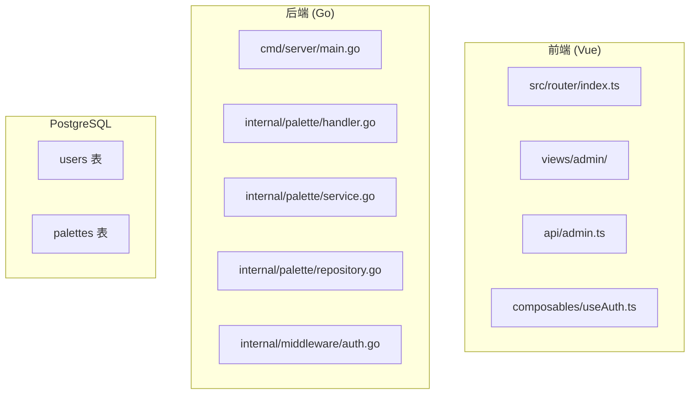

# Admin Manager v0.1 实现计划

## 系统架构概览



## TODO 清单

### Phase 1: 数据库与后端基础设施

- [ ] **DB Migration**: 创建 `008_add_role_to_users.sql` - 为 users 表增加 role 字段，默认 "user"
- [ ] **DB Migration**: 创建 `009_create_palettes_table.sql` - 创建 palettes 表，包含所有需求字段
- [ ] **Model**: 创建 `backend/internal/palette/model.go` - Palette 数据模型
- [ ] **Repository**: 创建 `backend/internal/palette/repository.go` - 数据库操作
- [ ] **Service**: 创建 `backend/internal/palette/service.go` - 业务逻辑
- [ ] **Handler**: 创建 `backend/internal/palette/handler.go` - API 处理器

### Phase 2: 后端 API 实现

- [ ] **Admin API**: GET `/api/admin/palettes` - 列表（支持筛选、分页）
- [ ] **Admin API**: GET `/api/admin/palettes/:id` - 获取单个
- [ ] **Admin API**: POST `/api/admin/palettes` - 创建
- [ ] **Admin API**: PATCH `/api/admin/palettes/:id` - 更新
- [ ] **Admin API**: POST `/api/admin/palettes/:id/publish` - 上架
- [ ] **Admin API**: POST `/api/admin/palettes/:id/unpublish` - 下架
- [ ] **Admin API**: DELETE `/api/admin/palettes/:id` - 删除（软删除）
- [ ] **Public API 调整**: GET `/api/palettes` 只返回 published
- [ ] **Public API 调整**: GET `/api/palettes/:id` 权限控制

### Phase 3: 前端 Admin 页面

- [ ] **Admin 路由**: `/admin` - Dashboard
- [ ] **Admin 路由**: `/admin/palettes` - Palette 列表
- [ ] **Admin 路由**: `/admin/palettes/new` - 新建表单
- [ ] **Admin 路由**: `/admin/palettes/:id/edit` - 编辑表单
- [ ] **Admin API Client**: 创建 `src/api/admin.ts`
- [ ] **Admin Dashboard**: 统计卡片 + 快捷操作
- [ ] **Admin Palette List**: 表格 + 筛选 + 操作按钮
- [ ] **Admin Palette Form**: 表单 + 实时预览

### Phase 4: 权限与安全

- [ ] **Admin 中间件**: 检查用户 role === "admin"
- [ ] **Admin 路由保护**: 未登录跳转 login，非 admin 显示 Access Denied
- [ ] **Seed 数据**: 创建 admin 用户脚本

## 数据库 Schema

### palettes 表

```sql
CREATE TABLE palettes (
  id UUID PRIMARY KEY DEFAULT gen_random_uuid(),
  slug VARCHAR(255) UNIQUE NOT NULL,
  name VARCHAR(255) NOT NULL,
  colors JSONB NOT NULL,  -- [{hex, rgb}]
  color_count INT NOT NULL,
  type VARCHAR(50) NOT NULL,  -- categorical, sequential, diverging, qualitative, heatmap
  chart_types TEXT[],
  journal_style TEXT[],
  discipline TEXT[],
  use_case TEXT[],
  tags TEXT[],
  accessibility JSONB,  -- {colorblind_safe, print_friendly, dark_background}
  source_type VARCHAR(50),  -- manual, figure_extracted, curated
  source_image TEXT,
  source_note TEXT,
  status VARCHAR(20) NOT NULL DEFAULT 'draft',  -- draft, candidate, published, archived
  version VARCHAR(50),
  created_by UUID REFERENCES users(id),
  created_at TIMESTAMPTZ NOT NULL DEFAULT NOW(),
  updated_at TIMESTAMPTZ NOT NULL DEFAULT NOW(),
  published_at TIMESTAMPTZ,
  archived_at TIMESTAMPTZ
);

CREATE INDEX idx_palettes_status ON palettes(status);
CREATE INDEX idx_palettes_type ON palettes(type);
CREATE INDEX idx_palettes_created_by ON palettes(created_by);
```

### users.role 字段

```sql
ALTER TABLE users ADD COLUMN role VARCHAR(20) NOT NULL DEFAULT 'user';
```

## API 设计

### Admin Palette API

| Method | Endpoint | Description |
|--------|----------|-------------|
| GET | /api/admin/palettes | 列表（支持 status, type, chart_type, journal_style, discipline 筛选） |
| GET | /api/admin/palettes/:id | 获取单个 |
| POST | /api/admin/palettes | 创建 |
| PATCH | /api/admin/palettes/:id | 更新 |
| POST | /api/admin/palettes/:id/publish | 上架（设置 status=published, published_at=NOW()） |
| POST | /api/admin/palettes/:id/unpublish | 下架（设置 status=candidate） |
| DELETE | /api/admin/palettes/:id | 删除（设置 status=archived） |

### Public Palette API 调整

- GET `/api/palettes` → 添加 `WHERE status = 'published'`
- GET `/api/palettes/:id` → 非 published 时，普通用户不能访问

## 前端页面结构

```
src/views/admin/
├── AdminDashboard.vue      # /admin
├── palettes/
│   ├── PalettesList.vue    # /admin/palettes
│   ├── PaletteForm.vue     # /admin/palettes/new, /admin/palettes/:id/edit
│   └── Preview.vue         # 实时预览组件
```

## 实施顺序

1. 先完成数据库 migrations
2. 再完成后端 API
3. 最后完成前端页面

## 已完成的工作

### 数据库迁移 (Migrations)
- ✅ `008_add_role_to_users.sql` - 为 users 表增加 role 字段，默认 "user"
- ✅ `009_create_palettes_table.sql` - 创建 palettes 表，包含所有需求字段
- ✅ `010_seed_admin_user.sql` - 创建 admin 用户 seed 脚本

### 后端 (Go)
- ✅ `internal/palette/model.go` - Palette 数据模型
- ✅ `internal/palette/repository.go` - 数据库操作
- ✅ `internal/palette/service.go` - 业务逻辑
- ✅ `internal/palette/handler.go` - API 处理器
- ✅ 更新 `internal/user/model.go` - 增加 Role 字段
- ✅ 更新 `internal/user/repository.go` - 读取 role 字段
- ✅ 更新 `internal/middleware/auth.go` - 增加 AdminRequired 中间件
- ✅ 更新 `cmd/server/main.go` - 注册 Admin Palette API

### 前端 (Vue)
- ✅ `src/api/admin.ts` - Admin API Client
- ✅ 更新 `src/api/auth.ts` - 增加 role 字段，导出 getAuthHeaders
- ✅ 更新 `src/router/index.ts` - 增加 /admin 路由和保护
- ✅ `src/views/admin/AdminDashboard.vue` - Admin Dashboard
- ✅ `src/views/admin/palettes/AdminPalettesList.vue` - Palette 列表页
- ✅ `src/views/admin/palettes/AdminPaletteForm.vue` - Palette 表单页
- ✅ `src/views/AccessDeniedView.vue` - 访问拒绝页

## 下一步

1. 运行数据库迁移
2. 启动后端服务
3. 启动前端服务
4. 测试 admin 用户登录和功能