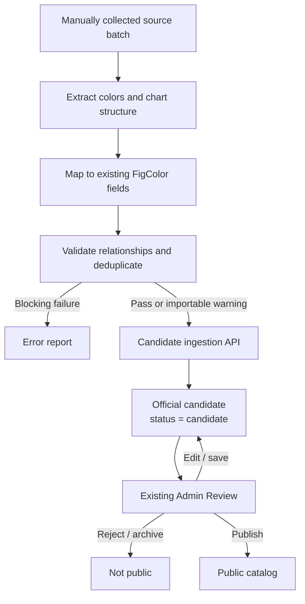

# FigColor Semi-Automated Palette Ingestion Pipeline — Implementation Plan

> Status: Codex-ready draft v0.9 (WP1 follow-up hardening complete; WP4 supplied-field subset passed; full WP4 remains in progress: 2026-08-02)
> Purpose: Codex implementation guide
> Scope: Batch ingestion, assisted extraction, canonical transformation, automatic validation, candidate creation, and one human review through the existing Admin Review publication workflow

## 1. Goal

Build a semi-automated ingestion pipeline that can:

1. Batch-read pending palette source packages.
2. Extract reusable colors and observable chart structure from each source.
3. Map extraction results into FigColor's existing Palette fields, chart applicability taxonomy, and color-role contracts.
4. Validate every proposal and produce actionable issues.
5. Submit automatically validated proposals through a dedicated backend boundary.
6. Create unpublished official-catalog candidates through the backend domain layer.
7. Let the existing Admin Review provide the only human review and publication decision.

The pipeline reduces repetitive data-entry work. It does not replace curator judgement, perform open-ended visual interpretation, or make AI-generated claims public automatically.

### 1.1 Pipeline summary

```text
Manually curated source package (scientific figure)
→ extract data colors and observable chart structure
→ map them to existing controlled FigColor fields
→ normalize and validate the canonical proposal
→ submit through the candidate ingestion API
→ create an unpublished Palette with status = candidate
→ review, edit, reject/archive, or publish in the existing Admin Review
```

The pipeline starts with a package resource whose primary evidence is a manually collected scientific-figure image. Its operational output is not merely a local JSON proposal: it is a pending official-catalog Palette already available in Admin Review for direct review, editing, and publication.

### 1.2 MVP I/O contract

```text
Primary input:
A manually curated source package containing one publication-quality
scientific figure that represents one identifiable palette and uses a chart
structure supported by the current FigColor chart registry.

Primary output:
An unpublished official-catalog Palette with status = candidate, visible and
editable in the existing Admin Review workflow.

The pipeline never publishes automatically.
```

MVP source curation is therefore responsible for excluding unsupported chart structures before a batch is run. If an unsupported chart structure is nevertheless detected, that package fails before candidate creation with `CHART_TYPE_UNSUPPORTED`; other valid packages in the batch may continue.

## 2. Success Definition

The pipeline is complete when an internal operator can place a batch of source packages in an inbox, run one resumable workflow, and submit automatically validated proposals as unpublished official-catalog FigColor candidates without manually reconstructing palette JSON. An admin can then inspect, correct, reject, archive, or publish each candidate through the existing Admin Review interface.

The following must remain true:

- `palette.colors` is the canonical color pool.
- Persisted colors have stable `color_id` values and explicit order.
- `hex` is canonical; RGB is derived.
- `chart_applicability` describes suitability, not rendering instructions.
- Preview cases remain separate from palette applicability.
- Generated role mappings and preview configuration are draft suggestions only.
- Public pages only use published palettes and published preview cases.
- An ingested candidate is catalog-scoped (`visibility = 'public'`, `owner_user_id = NULL`) but not publicly readable because `status = 'candidate'`; here “unpublished” describes API exposure, not private ownership.
- Project-created private/default palettes are never part of this ingestion path.
- The script does not write directly to production tables.

The governing abstraction rule is:

> FigColor does not perform open-ended semantic abstraction over a scientific figure. It extracts reusable color information and observable chart structure, then normalizes those results into the existing Palette schema, `chart_applicability`, and chart-specific color-role system.

“De-identification” means removing paper, journal, author, research-object, caption, and original-figure identity from the public Palette. It does **not** mean removing color order, palette type, chart structure, applicability, or role mapping, and it does not authorize a model to invent a parallel visual-style taxonomy.

The canonical processing sequence is:

```text
Scientific figure
→ identify colors and chart structure
→ map to existing controlled FigColor fields
→ validate field values and cross-field relationships
→ create canonical candidate
→ render with the existing Preview System
```

## 3. Non-goals

- Fully automatic publication.
- Treating an AI response as canonical truth.
- Open-ended semantic abstraction or invention of new style labels, taxonomies, or parallel metadata fields.
- Direct SQL insertion from the ingestion script.
- Replacing the existing Admin Review UI or publication permissions.
- Inferring scientific claims that are not supported by source evidence.
- Automatically merging duplicate or near-duplicate palettes.
- Changing project palette ownership, visibility, or Figure assignment semantics.
- Redesigning the scientific preview renderer.
- Storing generated export strings such as Python/R/CSS as editable truth.
- Downloading or scraping external figures as part of the initial implementation.
- Accepting source packages whose observed chart structure cannot be mapped to the current FigColor chart registry.
- Creating new chart types or applying fallback chart mappings during MVP ingestion.
- Publishing source figures, paper captions, DOI/citation/journal identity, author names, figure numbers, or research-object labels as Palette identity.
- External contributor accounts, submission APIs, submission staging tables, contributor review pages, or a contributor submission state machine.
- A separate script-side human confirmation or approval UI before candidate creation.

## 4. Confirmed Architecture

### 4.0 Repository audit baseline

This plan has been checked against the current worktree. Codex must treat the following as the implementation baseline and re-run the listed checks at the start of each work package because several relevant files are currently modified or untracked.

| Concern | Current repository fact | Required consequence |
|---|---|---|
| Backend stack | Go 1.21, Gin, `database/sql`, PostgreSQL; palette domain is under `backend/internal/palette/`. | Implement the ingestion HTTP boundary and transaction in Go. Do not introduce a second backend runtime. |
| Pipeline stack | The repository has Node ESM scripts but no TypeScript script runner and no image-processing dependency. | Implement the first CLI slice as Node ESM under `scripts/palette-ingest/`; add any native/image dependency only in WP2 with a documented portability check. |
| Official ownership | `Service.Create` already forces `owner_user_id = NULL`, `visibility = 'public'`, `origin = 'curated'`. | Reuse the ownership rule, but the ingestion adapter must also force `status = 'candidate'` and must not expose the broad manual-create DTO. |
| Palette lifecycle | Palette statuses are `draft`, `candidate`, `published`, `archived`. `DELETE /api/admin/palettes/:id` is already a soft archive despite its UI/API naming; the repository also contains an unused hard-delete method. Unpublish currently writes `draft`, not `candidate`. | Define MVP rejection as archive and preserve current unpublish behavior unless separately redesigned. WP7 should relabel the existing soft-delete action as Archive/Reject; ingestion must not call the unused hard-delete method. |
| Applicability | `chart_applicability` is authoritative when present; the service derives `chart_types`. Omitted, `null`, empty, and populated values have distinct write semantics. | Ingestion must send a populated authored applicability value and either omit `chart_types` or send the exact derived value. Never send `null` as a shortcut. |
| Chart registry | Canonical preview chart types are the six entries in `src/lib/chart-types/registry.ts`; broad legacy filters in `src/types/palette.ts` are a different taxonomy. | Mapping and preview suggestions must target the six registry IDs. Legacy labels may only pass through an explicit compatibility map. |
| Controlled metadata | The current runtime source for `JOURNAL_STYLES`, broad legacy `CHART_TYPES`, `DISCIPLINES`, `USE_CASES`, `AVOID_CASES`, and `TAGS` is `src/types/palette.ts`. Go validates canonical palette type and scientific chart applicability in `backend/internal/palette/validation.go`, and preview role/config contracts separately in `preview_case_validation.go`; Go does not validate those metadata arrays against the frontend lists. | WP1 creates the ingestion contract source and drift tests. Backend enforcement of metadata vocabularies is required before candidate import/AI mapping, but is not part of the existing canonical validator and must not silently tighten `POST /api/admin/palettes`. |
| Field naming | PostgreSQL/Go/admin API use `discipline`, `use_case`, and `avoid_case`; the normalized frontend model uses `disciplines`, `use_cases`, and `avoid_cases`. The frontend model declares optional `description`, but neither the Palette table nor Go model persists it. | Source/proposal contracts may use the normalized plural names, but the ingestion backend adapter must explicitly map them to the existing singular API/database fields. `description` is removed from the MVP ingestion contract; adding it would require a separately approved Palette schema change. |
| Preview persistence | `CreatePreviewCase` validates then writes through `database.DB` without a transaction. Transaction-aware read/update/lifecycle helpers already exist, but there is no `CreatePreviewCaseTx` or `CreatePaletteTx`. | WP6 needs one aggregate transaction owner and new transaction-aware create methods for palette + applicability JSON + draft previews + ingestion record. Calling existing services or HTTP handlers sequentially is not atomic. |
| Validation issue shape | Go and frontend canonical validation currently share only `{path, code, message}`. `severity` and `source` do not exist in the canonical issue type. | The pipeline may enrich issues with `severity/source` in proposal artifacts and ingestion evidence, but the backend domain validator remains the three-field shape. The ingestion adapter must map/enrich explicitly rather than changing every existing response in WP1. |
| Public DTO | `PublicPaletteDTO` embeds the full `Palette`, whose current fields include `source_image`, `source_note`, `created_by`, and other admin-oriented fields. Existing tests only protect preview-case filtering, not an allow-list of Palette fields. | Internal ingestion evidence must live in a separate table/DTO. Before WP6 completes, replace embedding with an allow-listed public DTO or add equivalent explicit field exclusion plus leakage tests; never store private evidence in `source_image`/`source_note`. |
| Idempotency/audit | No ingestion receipt, proposal record, normalized hash, or idempotency table currently exists. | A database migration is required before the real submit endpoint. An in-memory or artifact-only idempotency check is insufficient. |
| Admin evidence UI | Candidate filtering/editing and preview editing exist; ingestion evidence and warning acknowledgement do not. | WP7 is a real UI/API delta, not automatic compatibility. Candidate list compatibility can be reused, evidence display cannot. |
| Publication validation | `Service.Publish` currently checks only official-catalog ownership and then updates status; it does not rerun full Palette/applicability/preview validation. Preview publication has stronger lifecycle/validation logic. | Candidate import remains safe from public reads, but WP7 must add authoritative backend publication validation before relying on Admin Review as the final quality gate. Frontend form validation is not sufficient. This does not block WP1. |
| Authentication | `/api/admin/...` routes apply `Auth` then `AdminRequired`; `Auth` reloads the user and writes server-side role/user ID into `authctx`. | Register ingestion under the same admin group and take the audit actor only from `authctx`; never accept role or actor identity from JSON. |
| Migrations | The highest migration file in the current worktree is `018_expand_palette_preview_chart_types.sql`; migrations `016`–`018` are currently untracked. There is no application migration runner or schema-migration ledger; README documents manual `psql` application. | Reserve `019` for the future ingestion-record migration only after `016`–`018` are committed/accepted. Filename order does not prove a database has applied them; WP6 preflight must verify the target database separately. WP1 creates no migration. |
| Tests | Frontend tests run through the explicit Vite module list in `scripts/run-tests.mjs`; backend tests use `go test ./...` and scripted `database/sql` transaction fixtures. | Every work package must run focused tests plus both full suites at its integration stop point. New frontend tests must also be registered in `run-tests.mjs`. |

Compatibility invariants for all implementation work:

- Do not change the JSON contract of `POST /api/admin/palettes` or project-private palette creation.
- Do not persist ingestion-only fields in `Palette`, `RawPaletteDTO`, or public source fields.
- Do not import frontend TypeScript directly from the Node CLI or Go backend. Generate or validate language-specific artifacts from one versioned contract source.
- Do not rely on the current worktree being clean, and do not overwrite unrelated user changes.
- Reuse the existing palette color normalization, applicability rules, preview validation, authentication middleware, and public-read filters; extract shared helpers only when tests preserve existing behavior.

WP0 decisions that unblock WP1:

- Unknown source-manifest fields are errors in schema v1 (`additionalProperties: false`); forward-compatible additions require a schema-version increment.
- WP1 evidence remains local under `artifacts/palette-ingestion/`, is excluded from version control, and is not copied into Palette/public DTO fields. Long-term retention and admin retrieval remain deferred to Open Decisions 3–4.
- The initial executable pipeline is Node ESM; the authenticated domain boundary remains Go.
- The ingestion contract uses plural normalized metadata names and an explicit backend adapter to the existing singular Go/SQL names.
- WP1 may start without choosing an AI provider, creating database persistence, or resolving perceptual duplicate thresholds.

### 4.1 One human gate

The MVP has one human review: the existing Admin Review. AI and scripts perform extraction, normalization, validation, duplicate detection, and risk flagging, then submit a candidate automatically. Admin Review must expose enough source evidence and machine warnings for the admin to correct or reject the candidate before publishing it.

This retains two quality-control layers without duplicating human work:

| Layer | Executor | Result |
|---|---|---|
| Automatic preflight | AI, deterministic scripts, and backend validation | Invalid input is rejected; valid or explicitly flaggable input may become a candidate |
| Final review | Admin Review | Admin edits, publishes, rejects, or archives the candidate |

### 4.2 End-to-end flow



### 4.3 Trust boundaries

The pipeline has three explicit trust levels:

1. **Raw source** — untrusted, manually collected files and optional supplied FigColor fields; source identity remains internal.
2. **Machine suggestion** — extracted colors, detected chart structure, controlled-field mappings, and preview suggestions with confidence/evidence.
3. **Canonical database record** — created by authenticated backend service logic as an official-catalog candidate and still hidden from ordinary users until Admin Review succeeds.

No downstream layer may silently promote data to a higher trust level.

## 5. Candidate Lifecycle

The ingestion state is separate from `palette.status`.

```text
discovered
→ extracted
→ normalized
→ validation_failed | import_ready | flagged
→ importing
→ imported | import_failed
```

Rules:

- A proposal with blocking validation issues cannot be imported.
- Warnings and duplicate-risk flags may be imported only when the ingestion policy explicitly marks their issue codes as Admin-reviewable rather than blocking.
- `imported` requires a backend receipt containing the created palette identity.
- Re-running an imported proposal is idempotent and must not create a duplicate.
- Failed proposals remain traceable in run artifacts and may be corrected and retried.
- Imported palettes always begin with `status = 'candidate'`, `visibility = 'public'`, `owner_user_id = NULL`, and `origin = 'curated'`.
- `visibility = 'public'` identifies official-catalog ownership; it does not by itself make a record publicly readable. Public APIs must continue to require `status = 'published'`.
- `visibility = 'private'` is forbidden for ingestion candidates because it represents user-owned/private data and is excluded from the existing Admin Review boundary.

## 6. Input Contract

### 6.1 Recommended source package

For the MVP, source images are collected and curated manually. Each source package represents exactly one proposed reusable Palette, not one paper and not an arbitrary folder of figures:

```text
inbox/
  <source-key>/
    manifest.json
    figure.png                 # optional when colors are already supplied
    caption.txt                # optional, internal extraction evidence only
    notes.md                   # optional internal curator notes
```

Batch-level CSV/JSON may reference multiple packages, but the internal loader must normalize every input into the same `SourcePackage` contract.

### 6.2 Provisional source schema

```typescript
interface IngestionChartApplicability {
  chart_type:
    | 'bar_error'
    | 'boxplot_jitter'
    | 'line_multiseries'
    | 'heatmap_annotated'
    | 'scatter_grouped'
    | 'violin_distribution'
  suitability: 'best_fit' | 'recommended' | 'compatible' | 'limited'
  notes?: string
  source?: 'curated'
}

interface IngestionPreviewCaseInput {
  chart_type: IngestionChartApplicability['chart_type']
  template_id: string
  template_version: number
  schema_version: number
  color_roles: Record<string, unknown>
  preview_config: Record<string, unknown>
  seed_strategy: 'stable_id' | 'fixed'
  seed_value?: number
}

interface SourcePackage {
  source_key: string
  source_type: 'figure_image' | 'manual_colors' | 'curated_record'
  figure_path?: string
  supplied_fields?: {
    colors?: string[]
    type?: string
    disciplines?: string[]
    use_cases?: string[]
    avoid_cases?: string[]
    tags?: string[]
    chart_applicability?: IngestionChartApplicability[]
  }
  supplied_preview_cases?: IngestionPreviewCaseInput[]
  caption?: string
  curator_notes?: string
  internal_source?: {
    collection_batch?: string
    source_reference?: string
    rights_note?: string
  }
}
```

The preview input matches the existing `CreatePreviewCaseRequest` fields. It must not accept `id`, `palette_id`, `status`, or `is_primary`; ingestion owns draft/non-primary lifecycle values. WP1 JSON Schema must also enforce `seed_value` when `seed_strategy = 'fixed'` and validate role/config objects later against the selected registered template.

Input rules:

- `source_key` is required and unique within a batch.
- At least one of `figure_path` or `supplied_fields.colors` is required.
- File paths must resolve inside the configured batch root.
- `supplied_fields` uses current canonical field names and controlled values; it must not introduce aliases such as `generalization_hints`, `possible_chart_types`, `group_count`, or free-form visual-style fields.
- `supplied_preview_cases` must use the existing draft preview-case contract. Color-role mappings remain preview-case data rather than being embedded as a second Palette schema.
- `caption`, `curator_notes`, and `internal_source` are internal evidence only. They do not become public Palette fields and must not be copied into public name, tags, or recommendations.
- DOI, citation, journal, year, author, URL, and figure number are optional internal trace notes when already known; they are not source-package eligibility requirements and are not fetched by the loader.
- Supported image formats must be explicit and size-limited.
- Unknown manifest fields are blocking schema errors in v1.
- Raw source files are never modified in place.

Source-to-Palette adapter rules:

| Source package value | Persisted Palette value |
|---|---|
| `source_type = 'figure_image'` | `source_type = 'figure_extracted'` |
| `source_type = 'manual_colors'` | `source_type = 'manual'` |
| `source_type = 'curated_record'` | `source_type = 'curated'` |
| `disciplines` | Go/SQL `discipline` |
| `use_cases` | Go/SQL `use_case` |
| `avoid_cases` | Go/SQL `avoid_case` |

For the first slice, `journal_style` is persisted as an empty array, accessibility flags default to `false`, and `version` is omitted. `pipeline_version` belongs to the ingestion record, not `Palette.version`. These defaults may be expanded only through a versioned proposal schema.

### 6.3 Manual source eligibility and preparation

Manual collection is the confirmed MVP source strategy. It avoids spending the first implementation phase on crawler access rules, anti-bot behavior, unstable page structures, rate limits, PDF/HTML extraction differences, multi-panel segmentation, and low-quality or contextless image downloads. Crawler development remains out of scope.

A source is eligible when:

- One package can be bounded to one coherent proposed Palette.
- The data-encoding colors and their order or grouping can be inspected from the figure, legend, or supplied HEX values.
- The chart structure can be mapped to at least one chart type in the current FigColor chart registry.
- The image is sufficiently sharp to distinguish intended fills, strokes, points, or scale stops from anti-aliasing artifacts.
- Necessary legends are retained; unrelated panels, paper text, viewer chrome, logos, and large empty areas are cropped out where practical.
- The file is obtained through a lawful access path available to the curator and is used only as an internal extraction/review reference. FigColor does not republish the source image.
- The package contains no patient-identifiable, participant-identifiable, confidential, embargoed, or otherwise restricted information.
- `source_key` and `source_hash` are sufficient to detect retries and duplicate internal inputs even when bibliographic metadata is absent.

Preferred technical preparation:

- PNG is preferred for charts because it avoids JPEG color artifacts; high-quality JPEG/WebP may be accepted when necessary.
- Crop to the relevant panel plus its legend rather than the entire article page.
- Preserve the original data marks and legend swatches; do not recolor, enhance saturation, or manually clean pixels.
- Split different palettes into different packages. Multiple panels may share one package only when they demonstrably use the same ordered color logic.
- Photographs, microscopy images, decorative illustrations, and continuous natural-image gradients are not palette sources unless a supported chart layer and its data colors can be isolated reliably.
- Heatmaps and other continuous scales require visible endpoints and, when applicable, a midpoint or colorbar sufficient to reconstruct the existing scale-role contract.

Unsupported chart structures are excluded through manual source-package curation during the MVP. The loader or mapper must still verify this assumption. If no registered chart type can be produced, it emits a blocking `CHART_TYPE_UNSUPPORTED` issue and stops processing that package before candidate creation. It must not create an incomplete candidate, write an unknown value into canonical taxonomy, create a new chart type, or substitute an arbitrary supported chart.

Internal trace information is optional but, when recorded, must be accurate. Its purpose is duplicate investigation, audit, and rights handling—not public branding or recommendation.

### 6.4 Deferred compatibility mapping

After FigColor supports most common scientific chart structures, a later phase may introduce controlled fallback mappings for the remaining source types. This is not part of the MVP.

A future fallback mapping must:

- Be explicitly registered and approved, not generated ad hoc by AI.
- Map an observed source structure to an existing supported chart type only when that preview can faithfully demonstrate the Palette's color relationships.
- Be deterministic, versioned, testable, and reviewable.
- Preserve the observed source type as internal evidence without adding it to canonical taxonomy.
- Never imply that the source figure itself used the fallback chart type.

This later behavior is a compatibility mapping, not arbitrary coercion. Until such mappings are designed, unsupported packages remain excluded or fail with `CHART_TYPE_UNSUPPORTED`.

## 7. Proposal Data Contract

The implemented contract must preserve the audited repository models summarized in Section 4.0. The following is the required separation of concerns; WP1 replaces its remaining `unknown` placeholders with versioned schemas.

```typescript
interface SuggestedValue<T> {
  value: T
  confidence?: number
  method: 'supplied' | 'deterministic' | 'ocr' | 'ai' | 'curator'
  evidence?: string[]
  requires_review: boolean
}

interface ColorSuggestion {
  provisional_id: string
  hex: string
  order: number
  label?: SuggestedValue<string>
  pixel_share?: number
  source_regions?: Array<{
    x: number
    y: number
    width: number
    height: number
  }>
}

interface PaletteIngestionProposal {
  proposal_id: string
  batch_id: string
  source_key: string
  source_hash: string
  pipeline_version: string
  schema_version: number
  colors: ColorSuggestion[]
  palette: {
    name: SuggestedValue<string>
    type: SuggestedValue<string>
    disciplines: SuggestedValue<string[]>
    use_cases: SuggestedValue<string[]>
    avoid_cases: SuggestedValue<string[]>
    tags: SuggestedValue<string[]>
    chart_applicability: SuggestedValue<IngestionChartApplicability[]>
  }
  preview_case_suggestions: IngestionPreviewCaseInput[]
  internal_evidence: {
    source_reference?: string
    source_regions?: unknown[]
    extraction?: Record<string, unknown>
  }
  validation: ValidationReport
}
```

Before import, the validated proposal must be transformed into the actual backend ingestion DTO. Suggestion-only fields such as confidence, pixel regions, source identity, captions, curator notes, and raw model output must not leak into canonical Palette fields. Internal ingestion evidence must use a separate audited storage boundary.

Contract rules:

- `colors`, `type`, `disciplines`, `use_cases`, `avoid_cases`, `tags`, and `chart_applicability` must match the audited existing Palette semantics and controlled vocabularies. The Go ingestion adapter maps the plural proposal keys to `discipline`, `use_case`, and `avoid_case` without changing the existing admin API.
- `preview_case_suggestions` must match registered chart-specific preview and color-role contracts; it is not a free-form place for model-created rendering instructions.
- `name` is generated only after structural fields are resolved. It must describe the Palette's reusable properties and must not mention the source paper, journal, research object, or original figure. `description` is not an MVP ingestion field because the current Go/SQL Palette model does not persist it.
- The proposal contract may wrap existing fields with suggestion evidence, but it must not create a second domain taxonomy.

## 8. Extraction Strategy

### 8.1 Color extraction

Color extraction should combine deterministic image processing with optional AI assistance:

1. Decode and normalize the image without modifying the original.
2. Detect likely background, text, axis, grid, and anti-aliasing colors.
3. Cluster remaining pixels in a perceptual color space such as CIELAB.
4. Merge near-identical colors using an explicit, tested threshold.
5. Rank candidate colors using frequency plus spatial/semantic evidence.
6. Preserve supplied colors as higher-trust inputs when present.
7. Produce more candidates than the final palette when uncertainty is high.
8. Preserve enough evidence for the admin to include, exclude, reorder, relabel, or replace colors in Admin Review.

The extractor must preserve saturated minority colors that may encode small scientific groups; simple global top-frequency selection is insufficient.

Every extracted color should retain enough evidence for review, such as pixel share and representative source regions.

### 8.2 Existing-field mapping assistance

Assistance may use supplied canonical fields, observable figure structure, caption text, OCR, deterministic rules, and an optional multimodal model. Its task is to select values in the existing FigColor schema—not to summarize the paper or invent a visual vocabulary. Every non-curator mapping must record method, confidence, and evidence.

Rules:

- Prefer curator-supplied canonical fields and directly observable chart evidence over inference.
- Map `type`, `disciplines`, `use_cases`, `avoid_cases`, `tags`, and `chart_applicability` only to audited existing values.
- Do not infer or publish journal identity/style, paper topic, research object, author, institution, or source-specific category labels.
- Do not invent discipline, use case, avoid case, tag, or chart type. An unsupported chart structure is a blocking package error during the MVP; other unsupported controlled values must follow their audited field validation rules rather than being silently coerced.
- Generate `name` only from resolved structured fields; never use it as evidence for upstream classification.
- Low-confidence optional suggestions remain visibly flagged. A required field must be resolved and valid before candidate creation.
- AI output must conform to a versioned structured-output schema.
- The raw AI response may be retained in run artifacts for debugging, but it is not imported as canonical data.
- Model name, prompt version, and inference timestamp must be recorded for reproducibility.

### 8.3 Applicability and preview suggestions

- `chart_applicability` suggestions describe palette suitability only.
- Applicability suggestions may include internal rationale and figure-region evidence.
- `chart_types` are derived/synchronized by the backend according to existing rules.
- Preview suggestions must use registered chart types and templates.
- Data-encoding roles reference proposed stable colors through provisional IDs that are deterministically mapped to persisted `color_id` values during import.
- Utility colors may use only approved theme tokens.
- Suggested preview cases remain `draft` and cannot be primary or public before explicit publication review.
- Renderers do not infer roles, generate uncontrolled random data, or repair invalid proposals silently.
- Preview data and composition come from the existing deterministic Preview System, not from copying the source figure.

## 9. Normalization

Normalization must be deterministic, pure, and repeatable.

Required operations:

- Canonicalize HEX to uppercase `#RRGGBB` or the repository's audited canonical form.
- Derive RGB from HEX.
- Assign deterministic provisional color IDs before review.
- Preserve explicit color order.
- Normalize whitespace, arrays, enum spelling, and empty values.
- Convert raw singular/plural metadata only at the designated boundary.
- Resolve known legacy chart labels through explicit compatibility mappings.
- Reject unknown values rather than silently coercing them.
- Calculate `color_count` from `colors.length`.
- Produce a stable normalized content hash.
- Remove source-specific identity from canonical `name` and tags while preserving structural information already represented by controlled fields.

Normalization must not:

- Delete internal evidence required for audit; it must be separated from the canonical public model instead.
- Convert legacy `qualitative` or `heatmap` types silently.
- Guess missing required fields.
- Treat array index as permanent persisted color identity.
- mutate source-package data.
- Generalize into free-form adjectives or create fields outside the audited Palette and preview-case contracts.

Hashing contract for the MVP:

- Serialize the source-independent canonical candidate content as RFC 8785 JSON Canonicalization Scheme (JCS) UTF-8 bytes. The WP1 candidate skeleton contains only `schema_version`, normalized `colors`, unwrapped canonical `palette` values, and `preview_cases`.
- Compute `normalized_content_hash` as lowercase hexadecimal SHA-256.
- Compute `source_hash` from the manifest's normalized non-path content plus the raw bytes of referenced input files in lexicographic logical-name order. Absolute machine-local paths are excluded.
- Exclude `proposal_id`, `batch_id`, `source_key`, `source_hash`, `pipeline_version`, `internal_evidence`, `validation`, timestamps, model/debug output, suggestion method/review metadata, and the hash field itself from `normalized_content_hash`. The same canonical candidate content must have the same hash across batches and source packages.
- Use `proposal_id = <batch_id>/<source_key>` only as the batch-local human-readable proposal/artifact identity. It is not a Palette identity, duplicate fingerprint, canonical content identity, or standalone database idempotency key.
- Store a separate `proposal_artifact_hash` in each checkpoint. It is the SHA-256 of the RFC 8785 canonical form of the complete JSON-compatible proposal artifact and detects changes to evidence, validation, or any other proposal field without changing the meaning of `normalized_content_hash`.
- Any change to canonicalization rules increments `schema_version`; extractor/prompt changes increment `pipeline_version` even when the schema is unchanged.

## 10. Validation

Canonical frontend/backend validators currently use `{path, code, message}`. Pipeline proposal artifacts use the compatible enriched shape below; `severity` and `source` are ingestion metadata and are not assumed to exist on every legacy domain validation response:

```typescript
interface ValidationIssue {
  path: string
  code: string
  message: string
  severity: 'error' | 'warning' | 'info'
  source?: 'input' | 'extraction' | 'normalization' | 'domain' | 'duplicate' | 'import'
}

interface ValidationReport {
  valid: boolean
  issues: ValidationIssue[]
  findings?: ExactDuplicateFinding[]
}
```

At the ingestion boundary, existing three-field domain issues are wrapped with `source = 'domain'`; severity comes from a versioned ingestion issue-code policy. Message text is never used to derive severity or importability.

Frontend and backend logic must depend on stable `code` and `path`, not `message`.

### 10.1 Validation layers

1. **Input validation** — required files, manifest shape, path safety, formats, size limits.
2. **Extraction validation** — parseable HEX, confidence ranges, evidence structure, non-empty results.
3. **Canonical palette validation** — required existing fields, controlled values, stable color IDs, order, duplicates, color count, and absence of source-identity leakage.
4. **Applicability validation** — registered chart types, no duplicate chart type, at most one `best_fit`.
5. **Preview validation** — registered template, valid color references, role/config schema agreement, deterministic seed rules.
6. **Duplicate detection** — verified exact checks against the current batch and an explicit catalog snapshot; near-duplicate checks remain future full-WP5 work.
7. **Import validation** — idempotency key, authenticated actor, current schema/pipeline compatibility, and backend revalidation.

### 10.2 Blocking versus non-blocking issues

Errors block candidate creation. Warnings and informational issues are preserved for Admin Review. Each warning code must be classified as either importable-with-flag or blocking; the script cannot decide this ad hoc.

The MVP uses one candidate-validation model. It does not introduce a separate unresolved-candidate schema or a second ingestion validation tier. The existing Admin Review publication action may continue to run the repository's normal publication checks, but the ingestion pipeline does not create candidates with missing or fabricated chart applicability merely so that they can be repaired later.

Candidate blocking cases include:

- No usable colors.
- Invalid or duplicate color IDs.
- Invalid HEX.
- Missing the minimum internal source trace required by the resolved audit policy (`source_key` and source/input hash at minimum).
- Unknown palette or chart type.
- No registered chart type can be mapped from the observed source structure (`CHART_TYPE_UNSUPPORTED`).
- Duplicate applicability entries.
- Multiple `best_fit` entries.
- Preview role references a missing color.
- Preview template does not belong to the chart type.
- Invalid preview status or draft marked primary.
- Current-batch duplicate `source_key`, exact `source_hash`, or verified `normalized_content_hash`.

### 10.3 Duplicate detection

Duplicate detection produces review evidence; it does not merge records automatically. Detection, issue classification, and future database/import policy are separate decisions:

- Exact source identity uses `source_key` and `source_hash`. Same-batch duplicate source keys and exact source hashes are blocking errors for those processing units, but proposals are retained and no winner is selected.
- Exact canonical content uses only a successfully recomputed and verified `normalized_content_hash` version 1. This is not a second Palette fingerprint: it is the existing hash over schema version, ordered canonical colors, canonical Palette fields, and supplied preview cases. A hash mismatch is an integrity error and the proposal is excluded from duplicate grouping.
- Current-batch exact canonical matches are blocking errors. Cluster members are ordered by stable proposal/artifact identity, every member receives deterministic evidence, and unrelated valid proposals continue validation.
- Detector candidate identity is an entry contract selected by own-property presence, not nullish coalescing: an own `identity` property takes precedence even when its value is invalid, inherited `identity` values are ignored, and fallback to `proposal_id` is allowed only when the candidate has no own `identity` property. The resolved value must be a non-empty string and unique within the comparison batch. A present but invalid identity fails closed before any Map/index construction and cannot fall back, so no candidate can be silently overwritten or mistaken for itself.
- Catalog-snapshot exact content matches produce `EXACT_CATALOG_CONTENT_MATCH` findings and non-blocking warnings with `review_import_policy_status = deferred_wp6`. This records the match without deciding whether a future write blocks, warns, reuses a record, or requires an override.
- `proposal_id` remains artifact/business-event identity, not a duplicate fingerprint. Idempotency retry remains a separate WP6 concern. `normalized_content_hash` receives no database uniqueness constraint in this subset.

The pure catalog comparison input is `catalog-comparison-snapshot.schema.json` version 1. It contains only record identity, verified normalized hash, optional internal source hash, and access-scope fields. After Schema/identity validation, records are copied and sorted by unique `record_id`; both comparison and context hashing use this normalized snapshot, so input-array enumeration order cannot change findings, exact-index bytes, reports, or resume eligibility. The accepted view is official-catalog only (`visibility = public`, `owner_user_id = null`, `origin = curated`); candidate and published records participate, while draft records are explicitly excluded from exact catalog grouping. Private/default/user-owned records fail the comparison contract rather than being silently exposed. The detector never accesses a database or network. A future admin/internal read-only service is the comparison owner because current Palette rows do not reliably persist the ingestion `normalized_content_hash`; actual service/API integration remains outside this exact subset and must not be added to a public catalog DTO.

#### 10.3.1 Perceptual similarity contract v1

The authorized near-duplicate subset uses one versioned deterministic path:

- Source colors are canonical ordered 8-bit sRGB HEX values. Conversion version 1 applies IEC 61966-2-1 gamma decoding, the fixed OKLab D65 matrices, and Euclidean distance in OKLab (`ΔEOK`). Browser/CSS parsing and rendered pixels are not inputs.
- Perceptual policy version 1 compares only palettes with the same color count. Different counts are skipped; no padding, truncation, repetition, subset, or superset alignment is allowed.
- Matching is canonical-index, order-preserving, and one-to-one: index `i` matches only index `i`. Palette order remains semantic, reordered palettes are intentionally not made equivalent by similarity evidence, and tie-breaking is inapplicable because the mapping is fixed. This evidence rule does not alter ordered canonical colors or `normalized_content_hash`.
- A pair is near only when its unrounded mean `ΔEOK <= 0.035` and unrounded maximum pair `ΔEOK <= 0.060`. These conservative version-1 thresholds are intended to catch small per-color perturbations while requiring every aligned color to remain close; they are frozen as ingestion contract values, not claimed as a universal perceptual-quality standard. Finding evidence is numeric and rounded to at most six decimal places only after classification; JSON numbers do not preserve trailing zero display formatting.
- Exact content has precedence. A current-batch pair with the same verified `normalized_content_hash`, or a candidate/catalog pair with the same verified hash, is recorded only by the exact detector and receives no perceptual finding. Same source key/hash with different canonical content remains eligible for perceptual comparison.
- The exported perceptual detector always reruns exact entry validation against its current candidate and catalog inputs. It accepts no injectable exact-result proof, so a forged or stale exact result cannot bypass candidate identity, catalog Schema/access scope, or duplicate record-identity validation.
- Current-batch and eligible catalog candidate/published records are compared. Draft catalog records remain excluded under the exact catalog-snapshot policy. Snapshot records without `colors` remain exact-only; supplied `colors`, when present, are strict canonical uppercase HEX arrays. No detector reads the database or network.
- Stable warning codes are `NEAR_DUPLICATE_CONTENT` and `NEAR_CATALOG_CONTENT_MATCH`. Both are non-blocking warnings with `review_import_policy_status = deferred_wp6`; they do not select a winner or decide merge, override, skip, provenance link, or import behavior.
- The perceptual context hash covers perceptual policy version, color-conversion version, issue-policy version, the complete policy values, stable candidate identities and ordered colors, normalized catalog snapshot, and a stable summary of exact exclusions. Candidate/catalog enumeration order cannot change the context.
- Validation writes a dedicated schema-validated `similarities/perceptual-index.json`. Validated checkpoints require both `perceptual_context_hash` and `similarity_index_hash`; old/missing/forged artifacts, policy changes, or catalog-color changes cannot resume as perceptually validated.

Perceptual matching remains pure evidence. Different-count similarity, order-independent assignment, configurable thresholds, fuzzy metadata/name/slug matching, provenance actions, final import policy, and database/catalog integration remain future separately authorized work.

### 10.5 Deterministic human-readable validation handoff

WP5 writes `reports/validation-summary.md` as a deterministic derived view of the authoritative proposal, validation-report, exact-index, perceptual-index, and normalized catalog-snapshot JSON artifacts. The Markdown report is not a new truth source, does not recompute hashes or similarity classifications, and cannot change candidate validity, proposal/request content, or review/import decisions.

The report contains a batch summary followed by candidate sections sorted by explicit Unicode code-unit order. Each candidate shows stable identity, source identity, display name, normalized content hash, color count, ordered HEX colors, validation result, blocking issues before warnings, exact evidence, and perceptual evidence including the stored rounded mean/maximum values and index-aligned pair table. Findings are sorted by current identity, code, scope, and matched identity; matched pairs are sorted by current index then matched index. Empty sections render as `_None._`. Counts come only from the validated per-candidate reports and indexes. No wall-clock value, absolute path, temporary directory, HTML, or executable link is emitted.

User-controlled display text is NFC-normalized for rendering, Markdown table delimiters/backticks/backslashes are escaped, control and bidi-formatting characters are rendered as visible `\\uXXXX`, and display-only name/message values are deterministically truncated to 160 JavaScript string code units plus an ellipsis. Authoritative identities and hashes are never truncated, and no machine-readable artifact is modified.

Before rendering, the reporter validates all dependency Schemas, normalized dependency hashes, unique/non-empty candidate identities, finding-to-candidate binding, complete exact/perceptual evidence, supported policy/conversion/fingerprint versions, and issue-policy severity/blocking/review status. Unknown finding codes, ambiguity, corrupt evidence, unsupported versions, or hash/binding mismatches fail closed through structured reporter issues; they are never silently omitted.

Every `report.issues` entry whose source is `duplicate` must name an own property of `ISSUE_CODE_POLICY`; prototype-chain names are unknown. Its severity must equal the policy severity, and the policy must explicitly contain duplicate source, severity, boolean blocking, and non-empty review/import status. These checks complete before any blocking calculation, review-status lookup, or Markdown rendering, so optional chaining or display fallbacks cannot turn damaged policy input into a successful report.

The authoritative duplicate issue shape contains only `code`, `path`, `message`, `severity`, and `source`; it does not persist `matched_identity` or a separate `scope`. Therefore reporter consistency uses the strongest mapping that contract can express without parsing human-readable messages: for each candidate it compares structured findings and duplicate issues as a bidirectional multiset keyed by `code + path + source + severity`. Counts must match exactly, so missing issues, orphan issues, one issue reused for multiple findings, exact/perceptual cross-matches, and batch/catalog code cross-matches fail closed. Multiple findings with the same observable key are valid only when the duplicate issue multiplicity is identical. This proves observable contract consistency, not a nonexistent per-matched-identity issue binding.

Independently of that issue-shape limitation, every structured finding does carry `current_identity`. Before multiset validation, the reporter requires each finding's `current_identity` to equal the identity of the candidate report that contains it. A globally correct finding attached to another candidate fails with `REPORT_FINDING_CANDIDATE_MISMATCH`; global index/report set equality cannot substitute for this per-candidate ownership check.

After structural, own-policy, and multiset validation, candidate outcome is checked as `report.valid === !report.issues.some(blocking)`. Duplicate blocking comes only from the already-validated issue policy; other issue sources retain the v1 rule that severity `error` is blocking. Both a false success with blocking issues and a false failure without blocking issues are rejected. Reporter rejection occurs before report/checkpoint/batch-state success writes and does not alter authoritative validation outcomes or any caller-owned artifact.

The UTF-8 Markdown bytes are SHA-256 hashed. `batch.json` records the relative report path/hash, and each per-candidate checkpoint advances to the distinct `reported` stage with the same binding. `--resume` requires the report file, matching byte hash, matching upstream reports/indexes/context, and valid reported checkpoints; missing, tampered, or stale reports are rebuilt. This contract change advances only `pipeline_version` to `palette-ingest-wp5-reporting.1`; Schema version 1, issue-policy version 1, exact fingerprint version 1, perceptual policy version 1, and color-conversion version 1 remain unchanged.

This handoff is a local review artifact only. Winner selection, merge/override/skip/import actions, final duplicate import policy, provenance writes, database/catalog reads, HTTP, candidate writes, Go ingestion, Admin Review UI, threshold calibration/configuration, and WP6 remain deferred.

## 11. Admin Review Handoff

The initial implementation does not build a separate script-side review bundle or approval workflow. Automatically validated proposals are submitted as candidates, and the existing Admin Review is the only human review surface.

For one-step review to be safe, Admin Review should show or link to the following internal-only evidence:

- Source figure and optional internal source trace, clearly marked as non-public.
- Extracted color strip with include/exclude and reordering controls.
- HEX/RGB values and extraction evidence.
- Suggested existing Palette fields with method, confidence, and evidence.
- `chart_applicability` suggestions and rationale.
- Deterministic live previews for draft preview suggestions.
- Validation issues grouped by field.
- Exact and near-duplicate matches.
- Curator notes and acknowledgement of warnings.
- `Approve & Publish`, `Save Candidate`, and `Reject/Archive` actions.

Review rules:

- Only authenticated admins can publish, reject, or archive.
- The candidate retains its normalized proposal hash, source hash, pipeline/schema version, warnings, and duplicate evidence for audit and reproducibility.
- Admin edits are canonical record edits and do not require the script to recreate or reapprove a proposal.
- Publication still runs the existing complete backend validation and preview publication rules.
- Bulk publication remains out of scope until individual review is proven safe.
- Source figures, captions, internal references, and bibliographic notes must not appear in public Palette APIs or public UI after publication.

## 12. Database Import Boundary

### 12.1 Required import path

The script must call the dedicated authenticated ingestion endpoint. It must not call the general-purpose admin create route as its normal write path and must not connect directly to PostgreSQL for canonical writes.

Required behavior:

```text
POST /api/admin/palette-candidates
Idempotency-Key: <caller-generated opaque UUID>
```

For operation `palette_candidate_import_v1`, the caller generates one opaque UUID per logical submission and persists it to the local checkpoint before the first network attempt. Every retry of that logical submission reuses the same key. The server treats the value as opaque and never derives it from proposal identity, request content, or content hashes. Database uniqueness is scoped to authenticated actor/internal ingestion principal plus operation plus idempotency key.

The request payload fingerprint is lowercase SHA-256 over the RFC 8785 JCS UTF-8 bytes of the complete strict canonical ingestion request. It includes every business-semantic request field, including `proposal_id`, and excludes the idempotency key, HTTP headers, request time, and all transport metadata. The fingerprint is persisted with the idempotency record and stable receipt and is also bound into the future caller checkpoint.

The v1 canonical request has no outer transport envelope. `ingestion_metadata` additionally requires `validation_issues` and `duplicate_evidence` arrays (each may be empty) and permits an optional non-empty `source_reference` string of at most 2000 characters. An absent source reference is omitted, never encoded as `null`. These evidence fields are part of the complete canonical request and therefore participate in the RFC 8785 request fingerprint; they are not accepted through headers, query parameters, auth context, logs, or database reconstruction. The normalized-content hash remains source/evidence independent. The audit actor remains outside the body and comes only from authenticated server context.

The only accepted v1 pipeline version is the exact string `palette-ingest-wp5-reporting.1`; schema version is exactly integer `1`. There is no prefix, range, trimming, or case-folding compatibility. A future version must explicitly extend the allowlist and cross-language fixtures.

The same scoped idempotency key and fingerprint returns the original receipt without executing writes again. The same key with another fingerprint returns HTTP 409 / `IDEMPOTENCY_PAYLOAD_MISMATCH`. A reservation already in processing returns `IDEMPOTENCY_IN_PROGRESS` and never starts a second aggregate write.

The route accepts a validated internal `PaletteProposal` ingestion DTO, not the general `CreatePaletteRequest`. The strict ingestion DTO does not define `status`, `visibility`, `owner_user_id`, or `origin`; if any of these fields are supplied, the handler rejects the request as containing forbidden fields. The service still sets all four values explicitly rather than relying only on DTO filtering.

The handler must use a JSON decoder configured to reject unknown fields and trailing JSON values; Gin's normal binding alone is not sufficient to enforce the forbidden-field rule. Use stable error codes for malformed JSON, unknown fields, validation failure, idempotency conflict, and unsupported schema/pipeline versions.

Successful HTTP responses are the raw stable receipt, never a serialization of the service result and never an `{outcome, receipt}` or `{code, receipt}` wrapper. A newly committed aggregate returns `201`; stable replay and authoritative recovery after an ambiguous commit return `200` with byte-equivalent receipt semantics. The receipt requires `request_fingerprint` in addition to proposal/content/Palette/slug/status/preview identities. All errors use exactly `{ "code": string, "message": string }` with no additional fields or internal diagnostics.

The ingestion endpoint transport limit is exactly 262144 message-body bytes (256 KiB), excluding headers. The handler reads at most 262145 bytes, accepts an exactly 262144-byte body for subsequent parsing, and returns `413 REQUEST_BODY_TOO_LARGE` at 262145 bytes or above; chunked requests receive the same bounded-read enforcement and `Content-Length` is only an optional early rejection. Accepted content types are `application/json` with no parameters or with exactly one case-insensitive `charset=utf-8` parameter, parsed by the standard media-type parser. Missing/malformed types, JSON-like alternatives, non-UTF-8 or empty charset, duplicate charset, and every other parameter return `415 UNSUPPORTED_MEDIA_TYPE`.

The strict `{code,message}` error Schema begins only after the shared authentication and authorization middleware have admitted the request. Pre-handler `401`/`403` responses from the existing `Auth` and `AdminRequired` middleware are an explicit exception: they retain their established `{error: ...}` body because those shared middleware contracts also serve other APIs. The ingestion endpoint neither wraps those responses nor adds authentication codes to `error-response.schema.json`; the exception does not apply to any handler/request/service error.

The Node submission transport uses `INGESTION_REQUEST_TIMEOUT_MS = 30000` and `INGESTION_MAX_RESPONSE_BODY_BYTES = 65536`; it reads at most 65537 response bytes solely to detect overflow. Fetch uses `redirect: manual` and rejects every 3xx without following `Location`, so the Bearer credential is never forwarded. API URLs are parsed with the standard `URL` implementation, reject embedded username/password credentials, and require HTTPS except that plain HTTP is permitted only when `hostname` is exactly `localhost`, `127.0.0.1`, or `[::1]`. Timeout, connection interruption, redirect, truncated/malformed/oversized success, invalid receipt, and receipt-binding mismatch are submission-unknown outcomes: they retain the already-persisted canonical request fingerprint and idempotency key for same-body/same-key `--resume`.

| HTTP condition | Status / code / headers |
|---|---|
| Malformed, trailing, duplicate-key, invalid UTF-8, lone-surrogate, or invalid/overflow-number JSON | `400 INVALID_JSON` |
| Missing/unknown/invalid request field or domain/length/count failure | `422 INVALID_INGESTION_REQUEST` |
| Unsupported schema version | `422 UNSUPPORTED_SCHEMA_VERSION` |
| Unsupported pipeline version | `422 UNSUPPORTED_PIPELINE_VERSION` |
| Missing/wrong content type | `415 UNSUPPORTED_MEDIA_TYPE` |
| Body above the frozen endpoint limit | `413 REQUEST_BODY_TOO_LARGE` |
| Missing/blank/malformed/duplicate idempotency key | `400 INVALID_IDEMPOTENCY_KEY` |
| Unclassified internal failure | `500 INTERNAL_ERROR` |
| New success | `201` + raw stable receipt |
| Replay or authoritative recovered success | `200` + raw stable receipt |
| `IDEMPOTENCY_IN_PROGRESS` | `409`; integer `Retry-After` from database lease time, ceiling and minimum 1 |
| `IDEMPOTENCY_PAYLOAD_MISMATCH`, `PROPOSAL_ID_CONFLICT`, `EXACT_CONTENT_DUPLICATE` | `409`; same typed code; no `Retry-After` |
| `INGESTION_RETRYABLE_FAILURE` | `503`; integer `Retry-After` from persisted retry eligibility, ceiling and minimum 1 |
| `INGESTION_FAILED` | `409`; no `Retry-After` |
| `INGESTION_OUTCOME_UNKNOWN` | `503`; `Retry-After: 5` |

The existing `POST /api/admin/palettes` remains available for normal manual admin creation, but the ingestion script must not use it.

### 12.2 Import transaction

The backend must:

1. Authenticate and authorize the admin/curator actor.
2. Revalidate the complete payload server-side.
3. Recompute and verify the normalized content hash.
4. Check the idempotency key and apply the separately resolved exact-duplicate policy.
5. Transform the validated proposal into the canonical create model inside the backend service.
6. Create the palette with server-owned values: `status = 'candidate'`, `visibility = 'public'`, `owner_user_id = NULL`, and `origin = 'curated'`.
7. Persist colors with stable IDs and explicit order.
8. Persist `chart_applicability` and synchronize compatibility `chart_types` in the same transaction.
9. Create only valid preview cases with `status = 'draft'` and `is_primary = false`.
10. Write internal ingestion evidence/audit information using an audited non-public storage model.
11. Commit all changes atomically.
12. Return an import receipt with palette ID, slug, status, created preview IDs, and Admin Review URL/route identity.

If any step fails, no partial canonical palette or preview cases may remain.

The current repository has no aggregate transaction for this operation. WP6 must add one transaction owner at the service/repository boundary and transaction-aware create/read/slug-check methods; it must not call the existing palette and preview HTTP endpoints from inside the ingestion handler. This is safely implementable with the existing `database/sql` stack: begin one `*sql.Tx`, perform all inserts through Tx-aware repository methods, and commit once. A uniqueness conflict on the idempotency record rolls back the attempted aggregate; the service then reads the existing receipt outside the failed transaction and returns it only when the stored content hash matches.

### 12.2.1 Minimum persistence delta

After migrations `016`–`018` are accepted into the repository, add `019_create_palette_ingestion_records.sql`. The exact table name may follow repository naming conventions, but the minimum model is:

```text
palette_ingestion_records
  id UUID primary key
  proposal_id TEXT not null unique
  source_key TEXT not null
  source_hash CHAR(64) not null
  normalized_content_hash CHAR(64) not null unique
  operation TEXT not null
  idempotency_key TEXT not null
  request_fingerprint CHAR(64) not null
  processing_state TEXT not null
  palette_id UUID null unique references palettes(id) on delete restrict
  receipt JSONB null
  pipeline_version TEXT not null
  schema_version INTEGER not null
  validation_issues JSONB not null default '[]'
  duplicate_evidence JSONB not null default '[]'
  source_reference TEXT null
  actor_user_id UUID not null references users(id)
  created_at TIMESTAMPTZ not null default now()
  updated_at TIMESTAMPTZ not null default now()

  unique (actor_user_id, operation, idempotency_key)
```

`processing_state` is limited to `processing` and `succeeded`. A database check constraint requires `palette_id` and `receipt` to be null while processing and non-null after success. Failed aggregate transactions do not leave a successful receipt or partial Palette; reservation cleanup/retry behavior must not allow a second concurrent writer.

The future migration and ingestion service must preserve three distinct semantics:

- `idempotency_key` identifies one actor/principal-and-operation-scoped request/retry series. Its database constraint is unique `(actor_user_id, operation, idempotency_key)`. The record stores `request_fingerprint`, processing state, and the stable receipt. Same fingerprint replays; another fingerprint conflicts without mutation.
- `proposal_id` identifies the proposal artifact/business event and is globally unique in ingestion persistence. The same proposal and fingerprint returns its original receipt even under another idempotency key. The same proposal with another fingerprint returns HTTP 409 / `PROPOSAL_ID_CONFLICT`. No update/upsert may overwrite it.
- `normalized_content_hash` identifies exact canonical candidate content and is unique in ingestion persistence. A different proposal matching existing canonical content returns `EXACT_CONTENT_DUPLICATE` with the safely disclosable matched ingestion/palette identity and creates no candidate. Normal replay of the same proposal is resolved before this conflict rule.

Migration 019 must therefore provide database-enforced concurrency safety for scoped idempotency keys, global proposal identity, and exact normalized content. The persistence record additionally needs `operation`, `request_fingerprint`, a processing/succeeded state, and stable receipt data (or equivalent normalized receipt columns). Aggregate creation and reservation/finalization occur transactionally; service-layer check-then-write alone is insufficient. Explicit exact-content override, merge, winner selection, and skip-and-continue are not part of this contract and require a future permission, reason, and audit design.

**Migration 016–018 formal repository acceptance (2026-08-03): ACCEPTED.** Acceptance is backed by `backend/migrations/test_016_018.sh`, which creates and removes isolated PostgreSQL databases and verifies both the complete clean chain (`001`–`011`, `013`–`018`) and a representative pre-016 upgrade. This is repository migration acceptance only: it does not claim that any target, staging, or production database has applied these files. Target application still requires the repository's manual `psql` operational process and environment-specific backup/preflight evidence.

- **016 — figure assignment/base Palette FK: Accepted.** Schema delta adds `project_palettes.base_palette_id -> palettes(id) ON DELETE SET NULL` and rewires `figure_assignments.palette_id -> palettes(id) ON DELETE RESTRICT`. Backfill creates one canonical Palette for each legacy project palette without a base, preserves deterministic role order, emits current `{id, hex, rgb, label, order}` color objects (or one canonical fallback color), sets `base_palette_id`, and rewrites figure assignments. The upgrade fixture proves Palette/project-palette/figure row preservation, exact ordered color/RGB backfill, and the new FK targets. The migration is one explicit transaction; an invalid legacy base reference is failure-injected and proves the old figure FK and all prior state are restored. After data repair, rerunning 016 is a supported recovery path.
- **017 — ownership and visibility: Accepted.** Schema delta adds `owner_user_id`, `visibility`, `origin`, and `source_palette_id`; adds owner/source FKs, visibility/origin/private-owner/fork-source/not-self checks, public/private indexes, fail-closed private/custom defaults, and non-null visibility/origin. Backfill leaves existing official rows public/curated while reclassifying project-generated palettes to private/custom/draft with their project owner and cleared publication time. Representative upgrade tests prove no Palette, project association, figure, or preview loss and verify repository-visible ownership semantics. Shared-owner, missing-owner, orphan-private, and public-project guards are part of the migration. The entire migration is transactional; a shared-base-palette/multiple-owner failure proves columns and data changes roll back, followed by successful repair-and-rerun recovery.
- **018 — preview chart-type expansion: Accepted.** Schema delta atomically replaces `chk_palette_preview_cases_chart_type` with the six authoritative chart types, adding `scatter_grouped` and `violin_distribution` without changing rows or preview lifecycle fields. Tests prove an existing published/primary `bar_error` preview survives unchanged, both new types insert successfully, an unknown type is rejected, and the constraint contains all six registrations. The existing explicit transaction provides rollback on constraint replacement failure; rerunning after 016/017 recovery succeeds.

The acceptance test also proves 016–018 can be rerun after a successful upgrade, ownership constraints reject ownerless private Palettes, unknown preview chart types fail, and row counts remain stable except for the intentional one-Palette legacy backfill. No destructive down migration is introduced; repository recovery follows the existing convention of transaction rollback, correcting the rejected legacy data, and rerunning the forward migration.

**Migration 019 prerequisite audit (2026-08-03): CLEARED FOR REPOSITORY IMPLEMENTATION.** Migrations 016–018 are formally accepted into the repository migration chain with executable clean/upgrade/rollback evidence. This does not constitute target-database application evidence and does not create or authorize migration 019 in this acceptance slice.

**Migration 019 schema and repository persistence implementation (2026-08-03): PASSED.** `019_create_palette_ingestion_records.sql` implements the frozen persistence model with globally unique `proposal_id` and `normalized_content_hash`, scoped unique `(actor_user_id, operation, idempotency_key)`, a unique nullable Palette binding, actor/Palette foreign keys, SHA-256/UUID/version/JSON/state checks, timestamps, and a receipt-binding check that requires the stable receipt's proposal, content, request fingerprint, Palette, candidate status, and preview IDs to agree with the stored record. `processing` rows require null `palette_id` and receipt; `succeeded` rows require both. Repository success binding additionally locks and verifies the processing record and actual Palette, requires receipt proposal/hash/fingerprint/Palette/status agreement, verifies the actual candidate status and slug, and requires every preview identity to be a valid unique UUID naming an existing preview owned by that Palette. Any mismatch rolls back the caller transaction. No target, staging, or production database application is claimed.

The repository claims a logical submission in a database transaction using `INSERT ... ON CONFLICT DO NOTHING`; after the unique index serializes a concurrent collision, it classifies in frozen precedence order: scoped key, proposal identity, then exact content. Equal scoped-key/proposal fingerprints return `IDEMPOTENCY_IN_PROGRESS` while processing or the stored stable receipt after success. Unequal scoped-key fingerprints return `IDEMPOTENCY_PAYLOAD_MISMATCH`; unequal proposal fingerprints return `PROPOSAL_ID_CONFLICT`; another proposal with the same content returns `EXACT_CONTENT_DUPLICATE` and its safe matched proposal identity. Receipt finalization is a guarded transaction-aware update from an unbound processing record, allowing future candidate aggregate writes to share its transaction; database checks independently enforce receipt/fingerprint/proposal/Palette consistency. The repository clones caller-owned JSON inputs.

Focused evidence is executable in `backend/migrations/test_019.sh`, `backend/migrations/test_020_repository.sh`, `backend/internal/palette/ingestion_repository_test.go`, and `backend/internal/palette/ingestion_repository_postgres_test.go`. It covers clean migration chain through 019, representative pre-019 upgrade, transactional DDL failure/repair/rerun, unique/check/FK enforcement, direct real-PostgreSQL repository calls, concurrent same-key loser behavior, actual JSONB persistence, rollback with no partial Palette/receipt, stable replay, authoritative slug/status/preview binding, all replay/conflict/in-progress outcomes, guarded finalization, repository rollback, and caller-input immutability. The 016–018 audit and all Node, frontend build/test, and Go regressions also pass. This reaches only the WP6 persistence implementation subset stop point; aggregate service orchestration, HTTP, script submission, Admin UI, and publication remain outside this slice.

The persistence implementation subset intentionally defined no failed/stale/retry API, and its provisional `ReleaseProcessingClaim` operation was removed. The following design-only section now freezes recovery semantics before any migration 020, repository recovery API, or service orchestration is authorized.

### 12.2.2 Processing-claim failure, stale lease, and retry recovery contract

**Contract decision (2026-08-03): FROZEN.** The MVP uses lease-based `processing` ownership, a persisted `failed` state, and guarded retry on the original ingestion record. It never deletes or replaces a reservation. The original actor/principal, operation, idempotency key, proposal ID, normalized content hash, and request fingerprint remain immutable for the lifetime of the record. `succeeded` is permanent and always replays its original receipt.

#### Alternatives considered

| Model | Correctness and multi-instance safety | Complexity and operations | Crash recovery and MVP fit | Decision |
|---|---|---|---|---|
| Permanent `processing`, manual recovery only | Prevents duplicates but converts every crash into an indefinite business lock. | Minimal code; highest ongoing operator burden. | No automatic crash recovery and poor unattended-script behavior. | Rejected. |
| `processing` plus terminal `failed`, no lease | Records known failures but cannot distinguish a live worker from a dead one safely. | Moderate schema work; recovery still depends on unsafe elapsed-time check-then-write. | Insufficient for multiple instances and unknown commit outcomes. | Rejected. |
| Lease-based `processing` plus persisted `failed` and guarded retry | Database CAS/row locking elects one attempt; immutable identity and stable success prevent duplicate Palettes. | Moderate, bounded migration/repository/service work; no coordinator required. | Recovers both known failures and crashes and fits caller-driven MVP retries. | Selected. |
| Lease plus heartbeat/background recovery worker | Can support long-running work and proactive recovery. | Adds scheduler, liveness, deployment, and operational coupling. | Unnecessary because all external preparation must finish before claim and the database aggregate is short. | Deferred. |

#### Authoritative state and attempt model

The logical record state machine is:

```text
absent
  -> processing(attempt=1, lease_token, lease_expires_at)

processing + valid current lease + any attempt number
  -> succeeded(receipt, palette_id)          [aggregate transaction + BindSuccess]

processing + known non-retryable failure + any attempt number
  -> failed(actual safe failure code, non-retryable)

processing + known retryable failure + attempt < 3
  -> failed(retryable metadata)              [known aggregate rollback, then guarded failure finalization]

processing + expired lease + attempt < 3
  -> processing(attempt+1, new lease token)  [same-key/same-fingerprint recovery CAS]

processing + expired lease + attempt >= 3
  -> failed(ATTEMPT_LIMIT_EXCEEDED, non-retryable)
                                               [close current attempt as lease_expired; no automatic successor]

processing + known retryable failure + attempt >= 3
  -> failed(ATTEMPT_LIMIT_EXCEEDED, non-retryable)
                                               [current attempt retains actual safe failure evidence]

failed + retryable + eligible + attempts remain
  -> processing(attempt+1, new lease token)  [same-key/same-fingerprint retry CAS]

failed + operator-authorized requeue
  -> processing(attempt+1, new lease token)  [audited manual CAS]

succeeded
  -> succeeded                               [stable replay only]
```

There is no transition to absent and no transition away from `succeeded`. A `failed` row is terminal for its completed attempt and remains the durable logical-submission record; only an eligible guarded retry starts a new attempt on that same row. Requeue never changes any identity or fingerprint field.

Transition ownership is divided as follows:

- `ClaimOrRecover` creates attempt 1 or classifies/recovers an existing record. PostgreSQL generates the opaque UUID lease token inside the claiming transaction; it is execution ownership, not a user, actor, host, or deployment identity.
- The aggregate service owns the short Palette/preview transaction. `BindSuccessTx` must receive the current lease token and require state `processing`, matching token, and an unexpired lease while it writes the receipt in that same transaction.
- After a known aggregate rollback, the service may finalize `processing -> failed` in a new short transaction only with the current lease token. If its CAS loses, it reads and returns the authoritative current state without another mutation.
- Same-key retry or an authorized operator owns `processing/failed -> processing` recovery through one database CAS. No process can recover a lease using only an in-memory elapsed-time check.

The lease duration is five minutes. It is application configuration read once at startup (`PALETTE_INGESTION_LEASE_SECONDS`), default `300`, restricted to `30..1800`; invalid configuration prevents startup. `lease_expires_at` is computed by PostgreSQL from database time, not application clock. Expiry acquisition and final-bind predicates use `clock_timestamp()`, because PostgreSQL `now()` is fixed at transaction start and is not an authoritative lease clock for a transaction that crosses expiry. All external I/O, proposal preparation, and validation must finish before `Claim`; only the bounded database aggregate runs under the lease. The MVP has no heartbeat. If later measurements show a legitimate aggregate can approach five minutes, heartbeat requires a separately reviewed contract rather than silently extending this one.

`attempt_count` starts at 1 and increments only when a new lease is won. At most three attempts may be acquired automatically; this limit controls successor creation, never success eligibility. Any attempt with the current unexpired lease—including attempt 3 and audited operator attempts 4+—may bind success. For any attempt, a known non-retryable failure directly produces non-retryable `failed` using the actual safe failure code in both the logical record and attempt audit; `ATTEMPT_LIMIT_EXCEEDED` never overwrites that cause.

When processing attempt 3 or any later operator-created attempt expires, `ClaimOrRecover` atomically closes the current attempt as `lease_expired` and changes the logical record to `failed`, `failure_code = ATTEMPT_LIMIT_EXCEEDED`, `failure_retryable = false`, with no `retry_eligible_at`; it does not insert an automatic successor and returns `409 INGESTION_FAILED`. When attempt >= 3 instead ends in a known retryable failure, `MarkFailed` directly writes the same exhausted/non-retryable logical state rather than leaving automatic retry eligibility. Its attempt audit row still closes as `failed` with the actual stable failure code and sanitized diagnostic summary, so exhaustion does not erase the cause. Only a new audited operator requeue may create the next attempt. Automatic retry is caller-driven; there is no background worker.

#### Failure, stale, retry, and unknown-outcome decisions

| Situation | Authoritative behavior |
|---|---|
| Claim committed; aggregate has not begun and a known failure occurs | CAS current token from `processing` to `failed`. Classify retryability; retain every reservation identity. |
| Palette/applicability/preview persistence fails | Roll back the complete aggregate transaction first. On a fresh transaction, CAS the current claim to `failed`; no Palette, preview, receipt, or succeeded state may remain. |
| Process crashes before `BindSuccessTx` | Leave `processing` untouched. Before lease expiry, retries report in progress. After expiry, the original scoped key and fingerprint may win recovery CAS on the same record. |
| Aggregate commit returns an unknown result | Never mark failed from the commit error alone. Read the claim on a fresh database connection: `succeeded` replays; active `processing` remains in progress; expired `processing` follows stale recovery. If the database cannot be queried, return outcome-unknown and require the caller to retry the same key. Atomic aggregate+receipt commit means there is no valid committed Palette with a processing record. |
| Processing lease is old but not expired | It is active regardless of `updated_at`; no takeover. |
| Processing lease is expired and attempt < 3 | It is stale. Same scoped key/fingerprint may CAS to a new processing attempt. A loser rereads and returns in-progress or replay. |
| Current valid lease, including attempt 3 or operator attempt 4+ | The attempt may complete through `BindSuccessTx`; attempt number never blocks success. |
| Any attempt has a known non-retryable failure | After confirmed rollback, `MarkFailed` closes the attempt and logical record as non-retryable using the actual safe failure code/summary. It does not substitute `ATTEMPT_LIMIT_EXCEEDED`. |
| Processing attempt >= 3 lease is expired | `ClaimOrRecover` CAS-closes the current attempt as `lease_expired` and sets the logical record to non-retryable `ATTEMPT_LIMIT_EXCEEDED`. It creates no automatic successor and returns `409 INGESTION_FAILED`; only a new audited operator requeue may continue. |
| Attempt >= 3 has a known retryable failure | After confirmed rollback, `MarkFailed` closes the current attempt with its actual safe failure evidence but sets the logical record directly to non-retryable `ATTEMPT_LIMIT_EXCEEDED`, without `retry_eligible_at`. It creates no automatic successor. |
| Same scoped key and same fingerprint | `succeeded`: replay forever. Active processing: in-progress. Stale processing: attempt recovery. Retryable failed and eligible: attempt recovery. Non-retryable/exhausted failed: stable failed response. |
| Same scoped key and different fingerprint | Always `IDEMPOTENCY_PAYLOAD_MISMATCH`; it cannot inspect, extend, or recover the lease. |
| Same proposal/same fingerprint under another key | `succeeded`: replay receipt. Processing: in-progress; the other key cannot recover ownership. Failed: return the stored failed outcome and instruct recovery with the original key or operator path. |
| Same proposal/different fingerprint | Always `PROPOSAL_ID_CONFLICT`, including when the matched record is stale or failed. |
| Different proposal with the same exact content | Always `EXACT_CONTENT_DUPLICATE`, including when the matched record is stale or failed; return only the safe matched identity/state. No second reservation or Palette. |
| Multiple instances attempt recovery | One conditional update wins and receives the new lease token. Losers reread after the winner commits. Palette creation and `BindSuccessTx` remain one transaction, so a worker that lost or outlived its lease rolls back its whole aggregate. |
| Operator/manual recovery | Admin/internal ingestion operators may requeue only stale or failed rows through an audited internal operation with a required reason. They cannot delete, change identity/fingerprint fields, bypass duplicate rules, mark success, or take over an active lease. No UI or endpoint is authorized by this contract slice. |

Retryable failures are limited to sanitized transient infrastructure outcomes after confirmed aggregate rollback, represented initially by `AGGREGATE_TRANSACTION_RETRYABLE`. Contract/validation/receipt-binding/integrity failures use their actual safe non-retryable code, initially `INGESTION_INTEGRITY_FAILURE`, at every attempt number. `ATTEMPT_LIMIT_EXCEEDED` is reserved for retryable failure or lease expiry at attempt >= 3; it never replaces a known non-retryable cause. Unknown commit is not a stored failure code until the authoritative read establishes rollback and a later guarded transition is safe.

Retry eligibility uses a fixed five-second backoff from `failed_at`; it is stored as `retry_eligible_at` and compared using database time. The original idempotency key is permanently retained. Failure storage contains only a stable code, retryable flag, timestamps, and an optional sanitized UTF-8 summary capped at 512 characters. It must not contain SQL text, stack traces, DSNs, headers/tokens, raw request/proposal JSON, source references, captions, curator notes, or provider output. Detailed diagnostics stay in protected server logs correlated by ingestion record ID and attempt number.

Every attempt is auditable. `palette_ingestion_attempts` uses insert-once, guarded-close semantics: each attempt inserts exactly one row; `(ingestion_record_id, attempt_number)` and `lease_token` are globally non-reusable; and the only permitted update is one guarded close from outcome `processing` to exactly one terminal outcome (`succeeded`, `failed`, or `lease_expired`). A close sets completion/outcome fields once. Terminal rows cannot be reopened, rewritten, renumbered, reassigned, or deleted. Recovery and operator requeue always insert the next attempt row; they never recycle or mutate a prior terminal attempt. Admin/internal evidence may expose record ID, immutable proposal/source/hash/version identities, state, attempt number, lease start/expiry, retry eligibility, stable failure code, sanitized summary, receipt, Palette identity, and actor identity. Lease tokens are secret execution capabilities and must never appear in HTTP responses, script checkpoints, Admin DTOs, logs, or UI. Public Palette DTOs expose none of this evidence.

#### Concurrency and transaction strategy

Recovery uses a row lock or a single conditional `UPDATE ... RETURNING` whose predicate includes record ID, expected state, current lease token where applicable, expiry/eligibility, and immutable request fingerprint. PostgreSQL `clock_timestamp()` decides lease expiry and eligibility. The unique constraints from migration 019 remain the outer protection for scoped key, proposal, content, and Palette identity. Advisory locks are not used: the ingestion row is the lockable logical resource, and adding process-scoped advisory ownership would create a second lock domain.

The recovered aggregate and `BindSuccessTx` use one transaction. The final bind predicate includes the newly acquired lease token and unexpired lease; it deliberately has no upper attempt-number predicate, so attempt 3 and operator-created attempt 4+ can succeed. Failure to update aborts and rolls back all candidate writes. A worker must never commit Palette/preview rows first and finalize the claim later. Known failure finalization runs only after the failed aggregate transaction is confirmed rolled back. Logical-record transition, current attempt guarded close, and any next-attempt insert occur in the same transaction. For an expired attempt >= 3, the exhaustion CAS closes the current attempt and marks the logical record failed without inserting a successor. Receipt presence always dominates recovery: any authoritative `succeeded` row returns its immutable receipt, regardless of stale client checkpoints, time elapsed, or operator action.

#### HTTP and script contract

| Outcome/code | HTTP behavior | Retry guidance |
|---|---|---|
| First success | `201` with stable receipt | Persist receipt/checkpoint. |
| `REPLAY` | `200` with the identical stored receipt | Treat as success. |
| `IDEMPOTENCY_IN_PROGRESS` | `409`; `Retry-After` is ceiling seconds until lease expiry, minimum 1 | Retry the same key and identical body. |
| `IDEMPOTENCY_PAYLOAD_MISMATCH` | `409`; no `Retry-After` | Do not retry with that key. |
| `PROPOSAL_ID_CONFLICT` | `409`; no `Retry-After` | Requires proposal investigation; no automatic retry. |
| `EXACT_CONTENT_DUPLICATE` | `409`; no `Retry-After` | Review matched identity; no override/merge/skip. |
| `INGESTION_RETRYABLE_FAILURE` before eligibility | `503`; `Retry-After` is ceiling seconds until `retry_eligible_at`, minimum 1 | Retry the same key/body; after eligibility that request may acquire the next lease. |
| `INGESTION_FAILED` (non-retryable or exhausted) | `409`; no `Retry-After` | Stop automatic retry; operator review only. |
| `INGESTION_OUTCOME_UNKNOWN` | `503`; `Retry-After: 5` | Never generate a new key; retry the identical request until an authoritative read resolves it. |

Error bodies use a stable `code`, non-sensitive `message`, and safe record/matched identity where applicable. They never return lease tokens or stored diagnostic details. The future script writes the idempotency key before its first request, never rotates it in response to these errors, honors `Retry-After`, records only safe code/timing/receipt data in its checkpoint, and treats only `201`/`200 REPLAY` as completion.

#### Schema, repository, and service implications

This contract requires a separately authorized migration 020; migration 019 must not be edited after repository acceptance. Migration 020 minimally:

- expands state to `processing | succeeded | failed` and updates receipt/state checks;
- adds `lease_token UUID`, `lease_started_at`, `lease_expires_at`, `attempt_count`, `failed_at`, `failure_code`, `failure_retryable`, `failure_summary`, and `retry_eligible_at` with state-specific checks and stale/retry indexes;
- adds an insert-once/guarded-close `palette_ingestion_attempts` table keyed by ingestion record and attempt number, with a globally unique non-reusable lease token, start/lease/completion timestamps, outcome (`processing | succeeded | failed | lease_expired`), stable failure metadata, recovery mode (`initial | automatic_retry | stale_recovery | operator_requeue`), operator actor/reason fields where applicable, and restrictive foreign keys;
- preserves all migration 019 unique identities and never backfills an existing succeeded receipt incorrectly. Existing processing rows are backfilled as expired attempt 1 so they require guarded recovery; existing succeeded rows receive completed attempt 1 evidence.

State checks are exclusive: `processing` requires current lease fields and null Palette/receipt/failure fields; `succeeded` requires the existing bound Palette/receipt and null current-lease/failure fields; `failed` requires null Palette/receipt/current-lease fields plus completed failure metadata. Retryable failure requires `retry_eligible_at`; non-retryable failure requires it to be null. Exhaustion from retryable failure or lease expiry at attempt >= 3 specifically requires logical `failure_code = ATTEMPT_LIMIT_EXCEEDED`, `failure_retryable = false`, and null `retry_eligible_at`; a known non-retryable failure at any attempt instead retains its actual safe code. No succeeded-state or bind check may cap attempt number. Expiry or eligibility alone never changes state—every transition is an explicit locked/CAS write that updates the matching attempt audit row in the same transaction. Migration 020 must enforce unique `(ingestion_record_id, attempt_number)` and unique `lease_token`, prohibit attempt deletes and identity/start-field updates, and use a database trigger or equivalently strong database rule to allow only one `processing -> terminal` close while rejecting terminal-row updates/reopen. Repository discipline alone is insufficient.

Repository implications are transactional `ClaimOrRecover`, lease-aware `BindSuccessTx`, guarded `MarkFailed`, guarded operator requeue, authoritative post-commit lookup, and insert-once/guarded-close attempt transitions. `BindSuccessTx` accepts every current unexpired lease regardless of attempt number. `ClaimOrRecover` may insert an automatic successor only when attempt < 3; for expired attempt >= 3 it writes exhausted failed state in one CAS transaction and returns `INGESTION_FAILED` without a successor. `MarkFailed` preserves actual non-retryable failure metadata at any attempt; only retryable failure at attempt >= 3 produces exhausted logical metadata while preserving the attempt row's actual failure code/summary. Operator requeue alone may insert attempt 4+. APIs return outcome plus record/attempt metadata without exposing the lease token beyond the service call boundary. Service implications are: complete external validation before claim; carry the lease token only in memory; create Palette/applicability/previews and bind success in one transaction; classify only known post-rollback failures; resolve unknown commits through a fresh connection; and map domain outcomes to the frozen HTTP table.

Required acceptance tests include:

- migration 020 clean-chain, pre-020 upgrade, state/check/index/FK constraints, expired-processing backfill, succeeded backfill, failure rollback, and repair/rerun;
- first lease acquisition, database-time expiry, active-lease refusal, stale CAS recovery, failed eligible retry, retry backoff, attempt increment, automatic attempt limit, and audited operator requeue;
- attempt 3 and audited operator attempt 4+ can bind success when their lease is current and unexpired;
- known non-retryable failure at attempt 1, 3, and 4+ preserves the actual safe code in both logical and attempt records and never substitutes `ATTEMPT_LIMIT_EXCEEDED`;
- expired processing attempt >= 3 atomically closes as `lease_expired`, produces non-retryable `ATTEMPT_LIMIT_EXCEEDED`, returns `409 INGESTION_FAILED`, and creates no automatic successor; concurrent exhaustion calls produce the same single close and no successor;
- known retryable failure on attempt >= 3 closes with its actual safe failure evidence while the logical record becomes exhausted/non-retryable with no retry eligibility or automatic successor;
- automatic retry/recovery creates a successor only from attempt < 3; after attempt >= 3, only a new audited operator requeue can create the next attempt;
- attempt rows insert exactly once, close exactly once from processing, reject terminal reopen/rewrite/delete, never reuse attempt number or lease token, and insert any attempt 4+ only through a new audited operator requeue;
- two-instance stale/failed recovery races with exactly one winner and no second Palette;
- old/expired/lost lease cannot bind success or mark failure, and its aggregate transaction rolls back;
- known pre-aggregate failure, aggregate rollback, crash-before-bind simulation, and failure-finalization CAS loss;
- unknown commit resolving to succeeded replay, processing/in-progress, stale recovery, and database-unavailable outcome-unknown;
- same/different key and fingerprint, proposal, and exact-content decisions for active, stale, failed, and succeeded rows;
- immutable stable receipt replay; original key/identity retention; no deletion path;
- failure-summary length/redaction, lease-token non-disclosure, append-only attempt audit, and Admin/public DTO separation;
- HTTP status/code/`Retry-After` mapping and script checkpoint reuse of the original key.

Deferred items are heartbeat, background recovery workers, automatic operator notifications, an Admin recovery UI/endpoint, active-lease force takeover, configurable backoff algorithms, more than three automatic attempts, override/merge/winner/skip policy, and target/staging/production migration application.

#### Migration 020 and repository recovery persistence evidence

**Implementation status (2026-08-03): PASSED.** `020_add_palette_ingestion_recovery.sql` implements the frozen lease/recovery contract without modifying migration 019. It expands the logical state to `processing | succeeded | failed`, adds the current lease, attempt count, bounded safe failure metadata and retry eligibility fields, and creates `palette_ingestion_attempts`. Database checks enforce mutually exclusive state shapes, receipt binding remains governed by the migration 019 constraint, and a deferred composite foreign key binds each logical record to its current attempt. Existing processing records become expired attempt 1 reservations eligible for guarded recovery; existing succeeded records receive completed attempt 1 audit evidence without changing their receipt or Palette binding.

Database triggers make reservations non-deletable and succeeded records immutable. Attempt rows are insert-once and delete-prohibited; identity/start fields are immutable, and the only update is one guarded `processing -> succeeded | failed | lease_expired` close. Unique `(ingestion_record_id, attempt_number)` and globally unique `lease_token` prevent reuse. Logical recovery transitions require the exact next attempt, an expired prior lease where applicable, and remain transactionally coupled to closing the old attempt and inserting the successor. The original scoped key, proposal, content hash, request fingerprint, and source identities never change.

The repository boundary now provides `ClaimOrRecover`, lease-aware `BindSuccessTx`, `MarkFailed`, `OperatorRequeue`, and read-only `Lookup`. Claim/recovery uses PostgreSQL row locks, unique constraints, database UUIDs, `clock_timestamp()`, and guarded state transitions; it does not use a service-side check-then-write race. `BindSuccessTx` accepts any current unexpired attempt, including attempt 3 and audited attempt 4+, while preserving all migration 019 Palette/slug/status/preview/receipt validation in the caller's aggregate transaction. A stale or lost lease cannot bind or mark failure. Unknown commit is deliberately lookup-only: the repository never infers failure or creates a successor when the authoritative read is unavailable.

Automatic stale recovery and retry create a successor only below attempt 3. At attempt 3 or later, expiry closes the attempt as `lease_expired`, and a retryable known failure closes it with its actual safe failure evidence; both produce logical non-retryable `ATTEMPT_LIMIT_EXCEEDED` with no successor. A known non-retryable failure at any attempt preserves its actual code in both logical and audit state. `OperatorRequeue` is the only primitive that can create attempt 4+, requires an operator actor and bounded reason, rejects active/succeeded/retryable rows, and records `operator_requeue` audit evidence; authorization and transport remain deferred to service/HTTP work.

Executable evidence is split between `backend/migrations/test_020.sh`, `backend/migrations/test_020_repository.sh`, and the Go unit/PostgreSQL tests. It proves clean chain through 020, real pre-020 upgrade/backfill, state/check/FK/index enforcement, transactional DDL failure and repair/rerun, append-only attempt constraints, concurrent claim/recovery/exhaustion with one winner, retry backoff, old-lease rejection, attempt 3 and 4+ success, retryable/non-retryable/expiry behavior at attempt 4+, operator actor/reason audit, stable replay and all identity conflicts, JSONB persistence, authoritative receipt binding, and rollback with no partial Palette/receipt. Caller-owned compound input remains unchanged.

This reaches only:

```text
Migration 020 schema = Passed
WP6 lease/recovery repository subset = Passed
WP6 recovery persistence stop point = Reached
WP6 overall = In progress
Target/staging/production migration application = Not verified
```

Aggregate service orchestration, HTTP/error mapping implementation, unknown-commit orchestration, startup lease configuration, script checkpoint/retry behavior, operator authorization/endpoint/UI, publication, WP7, and target database application remain deferred. The next separately authorizable minimum subset is aggregate service orchestration against this repository boundary; it must not implicitly authorize HTTP handlers, scripts, Admin UI, or publication.

#### Aggregate ingestion service orchestration evidence

**Implementation status (2026-08-03): PASSED AFTER BLOCKER REMEDIATION.** Review found and this slice closed two acceptance blockers in the initial implementation: `BindSuccessTx` no longer commits, rolls back, or otherwise ends its caller-owned transaction, and Go canonicalization now uses the RFC 8785 reference implementation instead of rejecting non-integer JSON numbers. The service remains the sole aggregate transaction owner, and actual Go/Node cross-language evidence binds both request fingerprints and normalized hashes.

The service exhaustively maps `CLAIMED`, `RECOVERED`, stable `REPLAY`, active processing, retry-not-ready, failed/exhausted, idempotency mismatch, proposal conflict, and exact-content conflict into transport-independent typed results. Only claimed/recovered results open an aggregate transaction. Replay and all non-owner outcomes perform no aggregate writes and never expose the lease token. Successful first responses return the receipt representation read back by `BindSuccessTx`, so the first result and later JSONB-backed replay are byte-stable.

The service owns one transaction containing candidate Palette creation, all draft preview inserts, receipt construction, and lease-aware `BindSuccessTx`. Minimal compatibility adapters `CreateCandidateTx` and `CreatePreviewCaseTx` reuse the existing Palette/preview validation and accept a caller-owned `*sql.Tx`; they never commit. The adapter forces `status=candidate`, `visibility=public`, `origin=curated`, null ownership/source Palette, draft/non-primary previews, and the authenticated actor as audit metadata. Palette insert, partial preview insert, receipt bind, or commit failure cannot leave an orphan Palette, preview, or receipt.

After a confirmed rollback, only explicitly classified validation/integrity failures are persisted non-retryable and only known transient database/dependency failures are persisted retryable. Unknown/unclassified internal errors return a safe typed internal result without storing raw evidence. A lost, expired, or superseded lease never calls `MarkFailed`; the service performs one bounded authoritative lookup. Panic and cancelled-context cleanup use rollback plus a fresh two-second cleanup context where authoritative failure finalization/read is safe. Lease tokens, SQL, stack traces, raw requests, and credentials never enter results, receipts, or persisted summaries.

`BindSuccessTx` now performs only lease/CAS and Palette/preview/receipt invariant validation and binding writes. Every bind error returns to the service in the still caller-owned transaction. The service then invokes rollback exactly once before classification: only rollback `nil` proves the aggregate did not commit; `sql.ErrTxDone`, connection/driver errors, cancellation, and every other rollback error are unconfirmed. Lost-lease errors always resolve through a fresh authoritative lookup. With confirmed rollback, receipt/invariant errors may guarded-mark non-retryable and known transient database errors may guarded-mark retryable; unclassified errors never become persisted guesses. With unconfirmed rollback, no bind category may call `MarkFailed`, and authoritative lookup or `INGESTION_OUTCOME_UNKNOWN` is mandatory.

Go JCS is implemented by the RFC author's Apache-2.0 `github.com/cyberphone/json-canonicalization` module pinned at `v0.0.0-20241213102144-19d51d7fe467`, wrapped by `backend/internal/jcs`. The wrapper additionally requires valid UTF-8 and strict JSON syntax before transformation. Node's pure helper retains ECMAScript number serialization and now exposes strict raw-JSON canonicalization with duplicate-key and lone-surrogate rejection. The shared `jcs-cross-language-fixtures.json` corpus covers integers, decimals, exponent boundaries, equivalent number spellings, negative zero, the representative RFC 8785 number vector, Unicode/emoji/accented text, UTF-16 Unicode-key ordering, quotes/backslashes/control escapes, nested/empty arrays and objects, booleans/null, duplicate keys, lone surrogates, non-finite overflow, invalid numbers, and trailing JSON.

Every Go `Commit` error is conservatively treated as ambiguous because `database/sql`/the PostgreSQL driver cannot reliably prove the server outcome from the returned error alone. The original transaction is discarded and the service performs exactly one lookup on a new/background context with a two-second deadline and no sleep or loop. Succeeded returns the stored receipt as `success_recovered_after_unknown_commit`; active processing, retryable failed, and persisted failed return their authoritative typed states. An unavailable/unconfirmed lookup returns `INGESTION_OUTCOME_UNKNOWN` with retry-after 5 and makes no mutation. A later request must reuse the original key; this slice deliberately does not acquire a new stale lease inside the same ambiguous invocation.

Startup configuration now validates `PALETTE_INGESTION_LEASE_SECONDS` once through the repository config boundary: default 300, inclusive range 30–1800, explicit seconds, and fail-fast invalid values. Retry backoff remains fixed at 5, automatic attempt limit at 3, and unknown-outcome retry-after at 5; `NewIngestionServiceWithConfig` rejects divergence from these frozen constants so application configuration cannot bypass database/repository attempt rules. There is no heartbeat, background sweeper, automatic operator requeue, or application-clock lease decision.

Focused unit tests cover validation-before-claim, immutability, created/replayed/in-progress/conflict/retry-not-ready/failed outcomes, explicit bind-error → rollback → lookup/mark ordering, confirmed versus unconfirmed rollback, transient versus integrity classification, lost-lease lookup, lease-token non-disclosure, panic cleanup, ambiguous commit, unconfirmable lookup, and configuration bounds. Repository tests prove a failed `BindSuccessTx` leaves the transaction open for caller rollback. Real PostgreSQL tests execute the complete migration chain and prove atomic first success, byte-stable replay without new Palette/preview/attempt, rollback after Palette insert, rollback after an actual preview insert, bind rejection rollback, persisted failure transition, and an actual successful PostgreSQL commit whose test seam reports transport ambiguity followed by a new-connection lookup of the stable receipt. A rollback-ambiguity seam performs a real PostgreSQL rollback but reports transport uncertainty; the service forbids `MarkFailed`, rereads the still-processing logical record on a new connection, and leaves no aggregate rows. Stale-worker acceptance uses complementary evidence rather than claiming one end-to-end service-A test: the PostgreSQL test manually orchestrates the old worker's `BindSuccessTx → Rollback` while a recovered service instance performs and commits the sole winning aggregate, and the service unit test independently proves the automatic `bind error → rollback → authoritative lookup` ordering with `MarkFailed` forbidden. The shared fixture test actually starts the Go helper process from Node and proves byte/hash equality rather than duplicating an algorithm in one runtime. The existing migration 020/repository PostgreSQL suite continues to cover multi-instance claim/recovery races, attempt 3 and operator attempt 4+ success/exhaustion, lost leases, constraints, and append-only audit behavior.

This reaches only:

```text
WP6 transaction ownership blocker = Resolved
WP6 RFC 8785 JCS blocker = Resolved
WP6 aggregate service orchestration = Passed
WP6 unknown-commit resolution = Passed
WP6 service transaction test subset = Passed
WP6 service orchestration stop point = Reached
WP6 overall = In progress
Target/staging/production migration application = Not verified
```

HTTP handler/router and status mapping, authentication/authorization wiring, the script submission client/checkpoint transport, operator authorization/UI, Admin Review integration, publication, WP7, target database application, and a complete WP6 dry-run receipt remain deferred. The next minimum subset requires separate authorization and must be selected from the remaining WP6 endpoint/security/script integration work; this service slice does not authorize it implicitly.

**WP6 HTTP contract resolution and evidence compatibility slice (2026-08-04): PASSED.** The canonical Node builder now places validation issues, duplicate findings, and optional source reference in `ingestion_metadata`; missing legacy report arrays become explicit empty arrays only at that single builder boundary, while malformed values and `null` source references fail closed. The Go strict DTO accepts the same fields without disabling unknown-field rejection, maps the original evidence JSON into existing persistence inputs, and computes the fingerprint over the complete raw canonical request before claim. The exact pipeline allowlist is `palette-ingest-wp5-reporting.1`. Shared complete-request fixtures execute through actual Node and Go JCS implementations and bind key-order/whitespace equivalence plus evidence-sensitive fingerprints. Receipt and error Schemas now freeze raw stable success and safe two-field errors. No HTTP handler, route, auth middleware, server injection, client, migration, repository, or transaction behavior was added.

**WP6 HTTP/auth implementation slice (2026-08-06): PASSED.** `POST /api/admin/palette-candidates` is registered once behind the authoritative `Auth -> AdminRequired` middleware chain. Its bounded transport parser accepts at most 262144 raw body bytes and only `application/json` with no parameters or exactly one case-insensitive `charset=utf-8`; it then applies strict I-JSON/JCS validation and the frozen request contract before invoking the service. The handler preserves the complete original canonical bytes, sources actor identity only from `authctx`, validates exactly one opaque UUID idempotency header, and maps every existing typed service outcome without changing claim/recovery or aggregate transactions. Created success is 201; stable replay and authoritative unknown-commit recovery are 200 with the original receipt JSON; conflicts, retryable/unknown outcomes, validation/version errors, and internal errors use the frozen safe post-auth `{code,message}` envelope, with authoritative `Retry-After` where required. Pre-handler 401/403 deliberately retain the shared middleware `{"error":...}` contract and cannot reach the handler or service.

Focused handler tests cover exact/over body boundaries including chunked input, Content-Type variants, strict JSON/I-JSON failures, header cardinality and UUID validation, raw-body and actor provenance, exhaustive result mapping, redaction, stable receipt shape, route uniqueness, missing dependencies, and the real Auth/AdminRequired order. Real PostgreSQL HTTP tests exercise the actual router, middleware, handler, service, repository, migrations, JWT and database roles for created/replayed/recovered success, evidence-only fingerprint mismatch, proposal/content conflicts, processing/retryable/terminal outcomes, stable receipt/fingerprint binding, malformed/oversized/unsupported/auth failure zero-write behavior, and aggregate rollback. The implemented Node submission client calls `buildIngestionRequest(proposal, vocabularies, validationReport)` with the final authoritative report; it does not rely on the default `proposal.validation`, which would omit duplicate findings that exist only in the completed WP5 report.

**WP6 Node submission transport and local end-to-end slice (2026-08-07): PASSED.** The separately named 30000 ms request timeout, 65536-byte raw response limit, 65537-byte overflow probe, zero-redirect policy, credential-free standard URL parsing, exact loopback HTTP exception, pre-request durable UUID/fingerprint binding, and unknown-outcome same-key recovery semantics remain authoritative. The pre-existing preview-hash blocker was corrected without changing the Schema or canonical body: ingestion `CreatePreviewCaseRequest.SeedValue` remains a pointer but now uses `omitempty`, so typed normalized-content reconstruction omits the key for `stable_id` while retaining non-zero and zero values for `fixed`. Because pointer decoding otherwise conflates omission and explicit JSON null, `prepareIngestion` separately rejects a present `seed_value: null` at the raw canonical-request boundary before hashing or claim.

The shared Node/Go JCS corpus now includes normalized preview inputs for stable-id, fixed seed 42, and fixed seed 0. Go tests decode those fixtures through the typed ingestion DTO, rebuild the exact normalized-content structure, and match the same canonical bytes and SHA-256 values that the actual Node and Go JCS processes verify. Existing complete evidence-bearing request fixtures continue to bind full-body request fingerprints, ordered arrays, and evidence semantics.

The isolated PostgreSQL CLI-to-HTTP harness runs migrations 001–020 and the real Node CLI, authenticated router/middleware, Go handler/service/repository, and database transaction. It proves: first stable-id submission returns 201 and one stable receipt; the pre-request checkpoint key, stored canonical request bytes, JCS fingerprint, receipt artifact hash, database receipt, Palette and draft preview are mutually bound; a direct same-key/same-body request returns the identical receipt with 200; subsequent `submit --resume` reports `already_submitted`; response loss leaves `submission_pending_or_unknown` with the original key/body/fingerprint and a committed single aggregate, then process-level resume obtains authoritative replay without duplication; evidence-only body change with the old key returns `409 IDEMPOTENCY_PAYLOAD_MISMATCH`; explicit null seed returns `422 INVALID_INGESTION_REQUEST` without a claim; user, invalid-token, and expired-token requests return the frozen auth failures without writes or secret persistence. Real Admin Review filtering returns both candidates, whose rows remain `status=candidate`, `visibility=public`, and owner null; public list/detail paths return neither candidate nor its draft preview. Migration 019/020, repository/service PostgreSQL, focused Node/Go, full Node/Go, and build regressions all pass. The closure hardening additionally proves that stable-id seed values `42` and `0` are rejected both by the HTTP request layer and directly by `prepareIngestion` before claim; fixed values `42` and `0`, omitted stable-id seed, and explicit-null rejection remain covered. Target/staging/production migration application remains unverified and is not implied by this local evidence.

```text
WP6 HTTP contract resolution = Passed
WP6 HTTP contract freeze stop point = Reached
WP6 HTTP handler implementation = Passed
WP6 authentication boundary = Passed
WP6 authorization boundary = Passed
WP6 HTTP/auth stop point = Reached
WP6 transport contract = Frozen
WP6 Go preview hash compatibility = Passed
WP6 Node submission client = Passed
WP6 checkpoint transport = Passed
WP6 submission recovery = Passed
WP6 local end-to-end submission = Passed
WP6 documentation closure = Passed
WP6 contract hardening = Passed
WP6 closure = Complete
WP6 overall = Passed and frozen
Admin UI integration = Ready, not started
Publication workflow = Not started
WP7 = Not started
Target/staging/production migration application = Not verified
```

Do not store raw figures, captions, curator notes, or raw model responses in PostgreSQL in the MVP. Store them in protected run artifacts and persist only a non-secret reference after the retention decision is resolved. Ingestion evidence is returned through a separate admin-only DTO/endpoint backed by `palette_ingestion_records`; it is never added to `Palette`. The public Palette DTO must become an explicit allow-list before ingestion evidence can ship. If no approved evidence storage adapter exists, Admin Review shows hashes, issues, canonical extracted swatches, and receipt metadata without pretending that the source image is persisted.

### 12.3 Import safety

- Imported records are invisible to ordinary users even though they use official-catalog `visibility = 'public'`, because public reads also require `status = 'published'`.
- Imported records must not use project-private ownership semantics accidentally.
- The public catalog continues to require `visibility = 'public'` and `status = 'published'`.
- Draft preview cases never appear in public API responses.
- A retry with the same idempotency key returns the original receipt or a clear conflict; it never creates a second palette.
- The backend does not trust client-supplied reviewer roles or publication state.

### 12.4 Proposed backend file boundary

Add a dedicated ingestion layer inside `backend/internal/palette/`:

| File | Responsibility |
|---|---|
| `ingestion_model.go` | Define the source-agnostic `PaletteProposal`, strict ingestion request, admin-only evidence DTO, and import receipt DTOs; reuse existing Palette/preview field contracts and keep proposal-only evidence outside canonical fields. |
| `ingestion_handler.go` | Implement `POST /api/admin/palette-candidates`; parse strict JSON, require authenticated admin, and map domain errors to stable API responses. |
| `ingestion_service.go` | Verify normalized hash/idempotency, revalidate, transform proposal to canonical data, and force candidate ownership/status fields. |
| `ingestion_repository.go` or existing repository transaction methods | Persist the complete candidate atomically without exposing a script-facing SQL API. Reuse existing repository operations when they already provide the required transaction boundary. |
| `ingestion_*_test.go` | Cover authorization, field escalation, validation, idempotency, rollback, visibility, Admin Review discovery, and publication separation. |

Route registration belongs in `backend/cmd/server/main.go` and must use the same `Auth + AdminRequired` middleware as the existing `/api/admin/...` routes.

### 12.5 Existing code integration map

The implementation must reuse and preserve these current boundaries:

| Area | Existing files | Required relationship |
|---|---|---|
| Admin Review | `src/views/admin/palettes/AdminPalettesList.vue`, `AdminPaletteForm.vue`, `AdminPalettesList.test.ts` | Imported candidates appear in the existing Candidate list and remain editable/publishable there. Add internal ingestion-evidence UI only if the stored contract supports it; never expose it through public Palette views. |
| Admin navigation | `src/router/index.ts`, `src/App.vue`, `src/views/admin/AdminDashboard.vue` | Keep existing admin routing/guard UX; backend auth remains authoritative. Dashboard candidate counts should include ingested candidates automatically. |
| Admin API contract | `src/api/admin.ts` | Preserve the general manual-create contract. Do not repurpose it as the proposal ingestion DTO. |
| Palette domain | `backend/internal/palette/model.go`, `validation.go`, `service.go`, `repository.go`, `handler.go` | Reuse canonical validation, normalization, stable color IDs, slug collision handling, and repository transactions. Ingestion adds a stricter adapter; it does not duplicate the domain model. |
| Authentication | `backend/internal/middleware/auth.go` | Resolve actor role from the authenticated backend context; never trust a client-provided role. |
| Canonical frontend model | `src/types/palette.ts`, `src/lib/palette/schema.ts`, `src/lib/palette.ts` | Keep proposal/evidence fields separate from canonical palette fields and existing normalization. |
| Preview cases | `AdminPreviewCaseEditor.vue`, `AdminPreviewCaseEditor.logic.ts`, `src/lib/api/adminPreviewCases.ts`, `preview_case_handler.go`, `preview_case_repository.go`, `preview_case_validation.go` | Optional ingestion previews are draft-only, non-primary, validated, and still require Admin Review before publication. |
| Database constraints | migrations `009_create_palettes_table.sql`, `013_persist_palette_color_ids.sql`, `017_add_palette_ownership_visibility.sql` | Preserve lifecycle values, stable color IDs, and the distinction between official-catalog ownership and project-private ownership. |

The script implementation belongs under `scripts/palette-ingest/`. It may read local proposal/checkpoint/receipt artifacts and call authenticated HTTP APIs, but it must contain no production SQL write path or database credentials.

## 13. Command-Line Workflow

The implemented CLI entry point and supported command forms are:

```bash
# Discover and validate source packages
node scripts/palette-ingest/cli.mjs scan --batch <batch-path>

# Run extraction and normalization
node scripts/palette-ingest/cli.mjs prepare --batch <batch-path> --resume

# Re-run validation without extraction
node scripts/palette-ingest/cli.mjs validate --batch <batch-path>

# Submit proposals whose authoritative validation reports are valid
node scripts/palette-ingest/cli.mjs submit \
  --batch <batch-path> \
  --api-base-url <api-base-url>

# Show batch status and receipts
node scripts/palette-ingest/cli.mjs status --batch <batch-path>
```

Operational requirements:

- Non-interactive mode for CI/automation and explicit exit codes.
- Resumable stages with per-proposal checkpoints.
- `--dry-run` for every write-capable command.
- Structured JSON logs plus concise human-readable summaries.
- No secrets, tokens, raw model payloads, or sensitive paths in normal logs.
- Failed proposals do not stop independent valid proposals unless `--fail-fast` is explicitly set.
- Import summary distinguishes created, already imported, skipped, rejected, and failed records.

## 14. Artifact Layout

Provisional run layout:

```text
artifacts/palette-ingestion/<batch-id>/
  batch.json
  proposals/
    <source-key>.json
  checkpoints/
    <source-key>.json
  validation/
    <source-key>.json
  evidence/
    <source-key>/
  receipts/
    <source-key>.json
  logs/
```

Rules:

- Raw source files remain in the source batch.
- Generated artifacts are versioned by `pipeline_version` and `schema_version`.
- Machine-generated artifacts are reproducible or explicitly marked non-deterministic.
- Local artifact retention and `.gitignore` policy must be decided in WP0/WP1.
- Source images, captions, internal source traces, and model payloads are not committed to the repository by default and are never public Palette assets.

### 14.1 Concrete implementation layout

```text
contracts/palette-ingestion/v1/
  source-package.schema.json
  proposal.schema.json
  ingestion-request.schema.json
  validation-report.schema.json
  checkpoint.schema.json
  batch-state.schema.json
  receipt.schema.json
  controlled-vocabularies.json
scripts/palette-ingest/
  cli.mjs
  lib/
  test/
backend/internal/palette/
  ingestion_model.go
  ingestion_handler.go
  ingestion_service.go
  ingestion_repository.go
backend/migrations/<next>_create_palette_ingestion_records.sql
```

`controlled-vocabularies.json` is the versioned source for ingestion-controlled values. WP1 must add drift tests comparing it with the frontend constants and backend acceptance rules. Refactoring the whole application to generated enums is optional; allowing the three copies to drift is not.

### 14.2 Codex execution protocol

Codex should execute one work package per change set and stop at its stated stop point. For every package:

1. Re-read `git status --short` and the exact files in scope; preserve unrelated worktree changes.
2. Record the package and acceptance criteria being implemented in the progress update.
3. Add or update tests before crossing a persistence, authorization, or public-visibility boundary.
4. Run focused tests while iterating, then run `npm test`, `npm run build`, and `(cd backend && go test ./...)` at integration stop points.
5. Report changed files, test results, remaining open decisions, and the next safe package. Do not silently continue into the next package.

Execution order is intentionally vertical-slice first: `WP0 → WP1 → WP4 (supplied-field subset) → WP5 (exact validation/duplicate subset) → WP6 → WP7 → WP2 → WP3 → finish WP4/WP5 → WP8 → WP9`. Partial packages must be reported as partial, with unchecked acceptance criteria carried forward. WP6 cannot begin until the evidence/idempotency migration design is implemented, and WP3's external-AI path cannot begin until Open Decision 1 is resolved.

## 15. Work Packages

### WP0 — Repository and Data Audit

**Goal:** Refresh and confirm the Section 4.0 audit against the exact implementation worktree, then resolve only the decisions that block WP1.

Audit:

- Current Go palette models, validators, repositories, services, handlers, and admin routes.
- Current database columns, migrations, palette status values, visibility/origin fields, audit fields, and constraints.
- Admin Add/Edit and Admin Review flows.
- Canonical frontend palette normalization and validation.
- `chart_applicability`, `chart_types`, preview-case DTOs, template registry, and renderer validation.
- Existing import/seed/dev scripts and their language/tooling patterns.
- Current test commands and fixture locations.
- Whether internal ingestion evidence already has a non-public persistence location and how public DTOs exclude it.

Deliverables:

- Updated Section 4.0 audit if the worktree has changed; do not create a duplicate audit document.
- Verification that candidate creation can enforce `status = 'candidate'`, `visibility = 'public'`, `owner_user_id = NULL`, and `origin = 'curated'` without weakening existing manual-create behavior.
- Confirmed DTO and transaction design for `POST /api/admin/palette-candidates`.
- Schema delta, if any.
- Updated plan with resolved provisional contracts.

**Stop point:** No ingestion implementation begins until the audit confirms the safe backend transaction path, strict request boundary, idempotency migration, controlled-field source, and internal-evidence/public-exclusion delta. Open Decision 1 blocks only the external-AI portion of WP3; it does not block the supplied-field and deterministic pipeline.

**WP0 result (2026-08-02): PASS.** The aggregate transaction is not present but is implementable without weakening existing routes; the strict DTO, future `019` migration, vocabulary source/drift strategy, local WP1 evidence boundary, and public DTO remediation are now specified. WP1 may start. Open Decisions 1–5 remain deferred to the work packages named in Section 20 and do not block the deterministic `manual_colors` WP1 slice.

### WP1 — Contracts, Fixtures, and Pipeline Skeleton

**Goal:** Establish versioned contracts and a resumable pipeline without extraction intelligence.

Tasks:

- Define source manifest schema.
- Encode manual source eligibility, one-package/one-Palette rules, and internal-only source identity in the contract and curator checklist.
- Define proposal, validation, checkpoint, and receipt schemas. Do not add a script-side approval/decision artifact.
- Add pipeline versioning and stable hashing.
- Create a batch runner with stage checkpoints and dry-run behavior.
- Create representative fixtures: supplied colors, figure image, malformed manifest, legacy labels, duplicate source, and partial metadata.
- Add schema validation and path-safety tests.
- Add controlled-vocabulary drift tests covering the ingestion contract, frontend constants, and backend validation.

Acceptance:

- The same input within the same batch produces the same `proposal_id`, `source_hash`, `normalized_content_hash`, and `proposal_artifact_hash`.
- The same canonical candidate content across batches, source keys, and equivalent source packages produces the same `normalized_content_hash`.
- `proposal_id` remains batch-local artifact identity, `source_hash` remains source-package/input identity, and `proposal_artifact_hash` remains complete proposal-artifact integrity identity; none is described as canonical Palette identity.
- Interrupted runs resume without redoing completed deterministic work.
- Malformed and unsafe inputs fail with structured issues.
- No database write exists in WP1.

**Stop point:** Stop after contract tests and skeleton CLI tests pass.

**WP1 result (2026-08-02): PASS after hardening.** Versioned Draft 2020-12 schemas are compiled and executed with Ajv before domain/vocabulary validation; valid manifests, generated proposals, and the minimal ingestion-request boundary are schema-tested. RFC 8785/SHA-256 identities now separate source identity, batch-local proposal identity, source-independent normalized candidate identity, and complete proposal-artifact integrity. Manifest and artifact symlink/real-path boundaries, atomic writes, resume validation, per-package failure isolation, and `scan`, `prepare`, `validate`, and `status` Node ESM commands are implemented. WP1 retains a minimal `buildIngestionRequest()` boundary only to prove schema shape and evidence/server-owned-field exclusion; WP4 remains responsible for the complete domain mapping and authoritative canonical conversion. Focused tests and the repository-wide frontend/build/backend suites pass. No database, HTTP, image extraction, OCR, AI, catalog lookup, migration, Admin UI, or candidate write behavior was added. Stop at WP1; the next authorized slice is the supplied-field subset of WP4.

**WP1 status:** Passed. **WP1 stop point:** Reached. **WP1 follow-up hardening:** Complete. The v1 contracts (`source package`, `proposal`, `ingestion request`, `receipt`, `validation report`, `checkpoint`, `batch state`, exact catalog comparison snapshot, and exact duplicate index) execute through Ajv Draft 2020-12 with `strict: true` and `validateSchema: true`; existing invalid source fixtures remain blocked by Schema, domain validation, or the path boundary that owns path traversal.

### WP2 — Deterministic Color Extraction

**Goal:** Produce reviewable color candidates with evidence.

Tasks:

- Implement image decoding and normalization.
- Implement perceptual clustering and configurable color merging.
- Detect common background/axis/text/anti-aliasing candidates.
- Preserve small but saturated/semantically distinct colors.
- Record pixel share and representative regions.
- Support curator-supplied colors as a higher-trust path.
- Add golden fixtures for charts with bars, lines, scatter points, violin/boxplot groups, heatmaps, neutral utility colors, and anti-aliased edges.

Acceptance:

- Output is deterministic for a fixed extractor version.
- Extracted colors are valid, ordered, traceable, and editable.
- Utility/background colors are flagged rather than irreversibly deleted.
- Known minority data colors are not lost in acceptance fixtures.

**Stop point:** Stop after color-extraction fixtures and visual review report pass.

### WP3 — Controlled Existing-Field Mapping Assistance

**Goal:** Map observable evidence into FigColor's audited existing fields and controlled vocabularies without open-ended semantic abstraction.

Tasks:

- Parse supplied canonical fields, captions, and curator notes as internal evidence.
- Add optional OCR.
- Add a provider interface for optional multimodal AI extraction.
- Define versioned structured output and prompt fixtures.
- Record method, confidence, evidence, model, and prompt version.
- Map only to audited FigColor enums/taxonomies.
- Flag low-confidence optional fields for review and block candidate creation when a required field cannot be resolved.
- Verify that the observed source chart maps to the current chart registry; emit `CHART_TYPE_UNSUPPORTED` and stop that package before candidate creation when it does not.
- Generate `name` only after the structural mapping is resolved, using only reusable Palette properties.
- Add explicit leakage checks for journal/paper/author/research-object/figure identity in public candidate fields.

Acceptance:

- Pipeline works without an AI provider when existing FigColor fields are supplied manually.
- Invalid model output cannot bypass schema validation.
- Unsupported taxonomy values are rejected; unsupported chart structures cannot enter Admin Review during the MVP.
- No unsupported or source-specific scientific claim becomes a canonical field.
- AI cannot create new tags, chart types, field aliases, or style taxonomies outside the audited registries.

**Stop point:** Stop after deterministic parsing and optional-provider contract tests pass.

### WP4 — Canonical Transformation and Draft Preview Suggestions

**Goal:** Convert extracted suggestions into a valid FigColor proposal.

#### WP4 supplied-field mapping contract

The authorized supplied-field subset transforms only a proposal that already passes proposal Schema and domain validation. Required arrays preserve curator order. Source-manifest metadata arrays are required in schema v1, so an explicitly supplied empty array remains `[]`; omitted `supplied_preview_cases` alone defaults to `[]`. No other missing field receives an inferred value.

| Proposal source path | Request target path | Transformation | Requirement | Validation owner | Default | Inference | Evidence class |
|---|---|---|---|---|---|---|---|
| `proposal_id`, `source_key`, `source_hash`, `normalized_content_hash`, `pipeline_version`, `schema_version` | `ingestion_metadata.*` | Exact copy into non-Palette envelope | Required | Proposal/request Schema; normalized hash integrity check | None | No | Internal ingestion linkage, not public Palette data |
| `colors[*].provisional_id/hex/order` | `palette.colors[*].id/hex/rgb/order` | Rename ID; derive RGB from canonical HEX; preserve array order | Required | Proposal and request Schema/domain validation | None | No | Canonical Palette |
| `palette.name.value` | `palette.name` | Unwrap the deterministic WP1 name | Required by current Go model | Proposal/request validation | The already-created deterministic proposal value only | No WP4 inference | Canonical Palette |
| `palette.type.value` | `palette.type` | Unwrap | Required | Controlled vocabulary and Go create rules | None | No | Canonical Palette |
| `palette.disciplines.value` | `palette.disciplines` | Clone in supplied order; Go adapter later maps to `discipline` | Required array, may be empty | Controlled vocabulary | No implicit value | No | Canonical Palette |
| `palette.use_cases.value` | `palette.use_cases` | Clone in supplied order; Go adapter later maps to `use_case` | Required array, may be empty | Controlled vocabulary | No implicit value | No | Canonical Palette |
| `palette.avoid_cases.value` | `palette.avoid_cases` | Clone in supplied order; Go adapter later maps to `avoid_case` | Required array, may be empty | Controlled vocabulary | No implicit value | No | Canonical Palette |
| `palette.tags.value` | `palette.tags` | Clone in supplied order | Required array, may be empty | Controlled vocabulary | No implicit value | No | Canonical Palette |
| `palette.chart_applicability.value[*]` | `palette.chart_applicability[*]` | Clone supplied `chart_type`, `suitability`, optional public/domain `notes`; force/preserve contract value `source = curated`; preserve order | At least one | Schema plus applicability domain validator | No generated entry | No | Canonical Palette |
| `preview_case_suggestions[*]` | `preview_cases[*]` | Deep clone supplied preview contract; preserve semantic arrays and role references | Optional; omitted source list becomes `[]` during proposal normalization | Request Schema plus generic preview validation, generated Node artifact from the authoritative TypeScript chart registry/template validators, seed rules, and Palette color-reference validation | `[]` only | No generated preview | Draft preview domain |
| `internal_evidence`, `validation`, source caption/curator notes, rights notes, paths, collection batch | No Palette or preview target | Excluded | N/A | Leakage tests | None | No | Internal-only evidence |

Preview cases and applicability are intentionally independent supplied lists in this subset: an applicability entry does not generate a preview, and a preview does not generate applicability. The source manifest already requires at least one authored applicability entry. A supplied preview may use another registered chart type; requiring a matching applicability entry is deferred because the current Phase 1 Preview System validates each preview against the Palette colors/template but does not establish that cross-list rule. WP4 therefore records and tests non-generation without inventing a new consistency constraint.

For `seed_strategy = fixed`, `seed_value` is a required integer and legal zero is preserved. For `stable_id`, `seed_value` is omitted and the implemented Go ingestion/runtime boundary uses the persisted Palette/Preview Case identity as the deterministic seed identity source; source key, batch, filesystem location, and request metadata are never seed inputs. The request Schema, HTTP request layer, and claim-before `prepareIngestion` boundary all reject a present stable-id `seed_value`, including `0`; every explicit `null` is also rejected rather than treated as omission.

The canonical request envelope is:

```text
ingestion_metadata   # source/proposal linkage; never part of Palette content identity
palette              # canonical supplied Palette domain payload
preview_cases        # supplied draft Preview Case payloads only
```

Validation order is fixed as proposal Schema → proposal domain/vocabulary → supplied-field mapping → request Schema → generic preview validation → chart-specific role/config validation → deterministic identity/integrity validation. Structural failure returns only structural issues; the adapter throws `IngestionRequestValidationError` and never returns a partial request. The chart-specific Node boundary uses a generated ESM artifact built from `src/lib/chart-types/registry.ts` and its six template validators; an automated rebuild comparison fails when that artifact drifts from the authoritative TypeScript source.

The TypeScript Preview System registry and template definitions remain the authoritative owner for supplied-preview chart/template/role/config acceptance and generate the Node ingestion validator artifact. The authenticated Go ingestion boundary is now implemented: strict request Schema validation runs before the handler invokes the service, `prepareIngestion` independently fails closed before claim, and typed normalized-content reconstruction is cross-language fixture-locked to Node JCS. Stable-id omission, fixed seed values including zero, and explicit-null rejection are unified across these ingestion boundaries. The broader Go preview CRUD validator still has its own domain issue-code vocabulary, but that separate API does not weaken or replace the versioned ingestion contract.

Tasks:

- Implement pure normalization into the audited canonical shape.
- Assign deterministic provisional color IDs.
- Derive RGB and color count.
- Generate applicability suggestions separately from preview suggestions.
- Use the existing chart registry to generate draft role/config suggestions.
- Render deterministic review previews through the shared renderer pipeline.
- Preserve legacy compatibility only through existing adapters.
- Keep source identity and extraction evidence outside the canonical public Palette and preview-case models.

Acceptance:

- No raw HEX appears inside persisted preview role mappings.
- All data roles reference valid provisional color IDs.
- Applicability contains no renderer configuration.
- Draft previews cannot be primary or public.
- Shared validation and renderer logic are reused rather than duplicated.

**Stop point:** Stop after canonical transformation and renderer integration tests pass.

**WP4 supplied-field subset result (2026-08-02): PASS.** The pure `buildIngestionRequest()` adapter now produces the strict envelope above, derives RGB/color count, preserves ordered colors and all supplied semantic-array order, validates request structure and domain rules, applies authoritative chart-specific role/config validation before returning, checks normalized identity, and excludes evidence/diagnostics. It does not generate previews, applicability, metadata, or inferred fields and does not call HTTP, Go, PostgreSQL, or the SVG renderer. Renderer integration and generated draft suggestions remain outside this supplied-only slice.

**Status summary (2026-08-03):**

- WP1 = Passed
- WP1 follow-up hardening = Complete
- WP4 supplied Palette mapping = Passed
- WP4 supplied preview mapping = Passed
- WP4 supplied-field mapping checkpoint = Reached
- WP4 supplied-field subset = Passed
- WP4 supplied-field subset stop point = Reached
- WP4 overall = In progress
- Full WP4 stop point = Not reached

The mapping checkpoint means a valid supplied proposal maps stably to the canonical ingestion request. The narrower supplied-field subset stop point is reached because supplied preview cases now pass authoritative chart-specific validation. The full WP4 stop point remains not reached because renderer integration and the remaining full-WP4 acceptance work have not been implemented. Do not describe the unqualified WP4 stop point as reached and do not treat another work package as automatically authorized by this subset result.

### WP5 — Validation, Duplicate Detection, and Reports

**Goal:** Make every proposal auditable before review.

Tasks:

- Implement layered validation and stable issue codes.
- Classify error/warning/info severity.
- Compare proposals within the batch and against catalog data through a read-only backend API/service.
- Add exact fingerprints and configurable perceptual similarity.
- Generate machine-readable and human-readable validation reports.
- Prevent candidate creation when blocking errors exist.

Acceptance:

- Every failed proposal has actionable `path`, `code`, and `message` values.
- Near duplicates are flagged with evidence and never auto-merged.
- Catalog comparison respects public/admin data-access boundaries.
- Importable warnings are explicit, recorded, and visible in Admin Review.

**Stop point:** Stop after validation and duplicate fixtures pass.

**WP5 exact validation / duplicate subset result (2026-08-03): PASS after determinism and identity-contract hardening.** The existing `validate` flow revalidates proposal and canonical request boundaries, recomputes normalized identity, excludes invalid/integrity-failed proposals from exact grouping, detects deterministic exact source/content clusters, classifies issues through a centralized versioned policy, and writes schema-validated per-proposal reports plus a batch exact index. Catalog records are normalized by stable record identity before comparison/context hashing. Explicit candidate identity is selected by own-property presence rather than nullish coalescing: a present but invalid identity fails closed and cannot fall back to `proposal_id`; fallback is allowed only when `identity` is absent. The catalog boundary is an explicit in-memory official-catalog snapshot contract; no database/network integration exists. Exact-stage checkpoint integrity remains preserved. That exact subset did not decide import policy, database uniqueness, candidate write, or human-readable report UI.

**WP5 near-duplicate / perceptual similarity subset result (2026-08-03): PASS.** OKLab/ΔEOK conversion and policy version 1, same-count canonical-index matching, joint unrounded mean/max thresholds, exact precedence, deterministic current-batch/catalog findings, dedicated similarity artifact, validation-report integration, and checkpoint/resume binding are implemented and fixture-tested. Near findings remain non-blocking `deferred_wp6` warnings. No different-count alignment, order-independent matching, configurable policy UI, import decision, database integration, HTTP, candidate write, or Admin UI was added.

**WP5 human-readable validation reporting subset result (2026-08-03): PASS.** `reports/validation-summary.md` is a deterministic, escaped, fail-closed derived view of validated JSON artifacts. It presents per-candidate input/schema outcomes plus exact and perceptual evidence without recalculation or decision-making, is byte-hashed and bound to a distinct reported checkpoint stage and batch state, and is rebuilt when missing, tampered, or stale. Reversed enumeration, repeated rendering, dependency corruption, unknown policy codes, and deep input immutability are fixture-tested. No import action, database/HTTP/Go integration, Admin UI, or WP6 behavior was added.

**WP5 reporting consistency hardening (2026-08-03): COMPLETE.** Reporter acceptance now also requires own-property duplicate policy lookup, exact policy severity/classification, bidirectional finding/issue observable-key multiplicity, and `report.valid` agreement with authoritative blocking semantics. Because duplicate issues do not store matched identity or independent scope, the contract explicitly avoids message parsing and does not claim stronger per-match binding. This is fail-closed enforcement of the existing reporting contract, so `palette-ingest-wp5-reporting.1` and all v1 Schema/policy/fingerprint/conversion versions remain unchanged.

**Status summary (2026-08-03):**

- WP1 = Passed
- WP1 follow-up hardening = Complete
- WP4 supplied-field subset = Passed
- WP4 supplied-field subset stop point = Reached
- WP4 overall = In progress
- Full WP4 stop point = Not reached
- WP5 exact validation / duplicate subset = Passed
- WP5 exact subset stop point = Reached
- WP5 overall = In progress
- Full WP5 stop point = Not reached
- WP5 exact subset post-pass identity hardening = Complete
- WP5 near-duplicate / perceptual similarity subset = Passed
- WP5 perceptual subset stop point = Reached
- WP5 human-readable validation reporting subset = Passed
- WP5 reporting subset stop point = Reached

These WP5 subset stop points do not authorize WP6. Full WP5 still requires actual admin/internal catalog read integration, calibrated/configurable future similarity policy work beyond the frozen v1 slice, and the final duplicate import policy.

**WP6 ingestion/idempotency persistence contract (2026-08-03): FROZEN; MIGRATION PREREQUISITE CLEARED.** Caller-generated opaque UUID keys, actor/principal-and-operation scope, full-request JCS SHA-256 fingerprints, replay/conflict/in-progress semantics, global proposal identity, blocking exact-content policy, receipt binding, and database-enforced concurrency constraints are resolved in Section 12. Migrations 016–018 have formal repository acceptance, and the separately authorized migration 019/repository persistence subset below now implements this contract. Target-database application remains separately unverified.

**WP6 ingestion/idempotency persistence implementation subset (2026-08-03): PASSED.** Migration 019 schema and the hardened repository persistence boundary pass focused migration, mocked transaction, and direct real-PostgreSQL integration tests. WP6 persistence subset stop point = Reached. WP6 overall = In progress. Target/staging/production migration application = Not verified.

**WP6 processing-claim failure/stale/retry recovery contract (2026-08-03): FROZEN.** Section 12.2.2 fixes the failed state, lease token/timeout, no-heartbeat MVP, retry eligibility/backoff/attempt limit, success eligibility at every attempt, automatic successor creation only below attempt 3, exhaustion for retryable failure/expiry at attempt 3+, preservation of actual non-retryable causes, insert-once/guarded-close audit rows, immutable reservation, database CAS, unknown-commit reconciliation, HTTP mapping, sanitized audit boundary, migration 020 implications, and acceptance matrix. This clears the design prerequisite for a separately authorized migration 020/repository recovery subset; it does not authorize or implement service orchestration.

**WP6 aggregate service orchestration subset (2026-08-03): PASSED AFTER BLOCKER REMEDIATION.** Repository-owned rollback was removed from `BindSuccessTx`; the service now owns bind-error rollback and treats only rollback `nil` as confirmed. The integer-only canonicalizer was replaced by pinned RFC 8785 JCS with strict raw-input validation and shared Go/Node fixtures executed across actual processes. PostgreSQL transaction, stale-worker, rollback-ambiguity, and unknown-commit regressions pass. WP6 service orchestration stop point = Reached. WP6 overall = In progress; HTTP, authentication/authorization, script client, Admin UI, publication, WP7, and target database application remain unimplemented.

### WP6 — Authenticated, Idempotent Candidate Ingestion

**Goal:** Import automatically validated internal proposals safely as unpublished official-catalog candidates.

Tasks:

- Add the authenticated `POST /api/admin/palette-candidates` endpoint and dedicated ingestion DTO/service boundary.
- Reuse canonical backend validation.
- Verify normalized content hash and schema/pipeline compatibility.
- Add idempotency storage or use an audited existing mechanism.
- Reject client control of `status`, `visibility`, `owner_user_id`, and `origin`; force the confirmed values server-side.
- Create palette, colors, applicability, and valid draft previews in one transaction.
- Persist minimum internal ingestion evidence and audit actor information outside public Palette DTOs.
- Return and store import receipts.
- Add authorization, rollback, retry, conflict, and public-leakage tests.

Acceptance:

- The script has no direct database credentials or SQL write path.
- Invalid, changed, or duplicate proposals cannot import.
- A failed aggregate transaction leaves no partial Palette, applicability, preview, or receipt; its immutable ingestion reservation follows the frozen failed/stale recovery state machine.
- Retrying the same validated proposal does not duplicate data.
- Imported palettes and draft previews are absent from public endpoints.
- Imported candidates are present in the existing Admin Review Candidate filter.

**Stop point:** Stop after backend security/integration tests pass and one dry-run receipt is inspected.

### WP7 — Existing Admin Review and Publication Integration

**Goal:** Hand imported candidates to the established publication workflow without creating a parallel publishing system.

Tasks:

- Make imported candidates discoverable in the existing Admin Review interface.
- Show internal ingestion evidence and import receipt identity to admins only.
- Revalidate the complete palette and preview payload before publish.
- Preserve the current primary-preview transaction rules.
- Verify public catalog ownership/visibility/status filters.
- Add end-to-end tests from source package to published palette.

Acceptance:

- Import does not imply publication.
- Admin can revise or reject an imported candidate before publish.
- Only explicitly published palettes and previews appear publicly.
- Existing manually created palettes continue to work unchanged.

**Stop point:** Stop after end-to-end acceptance and regression tests pass.

### WP8 — End-to-End Hardening and Regression

**Goal:** Prove that the simplified one-review workflow remains safe across ingestion, candidate editing, rejection, and publication.

Tasks:

- Add end-to-end coverage from source package to candidate and from candidate to each Admin Review outcome.
- Verify warnings, duplicate evidence, internal source evidence, and preview drafts remain visible to admins but absent from public APIs/UI.
- Verify all candidate and draft-preview public leakage boundaries.
- Verify existing manual Admin creation and project-private palettes remain unchanged.
- Test batch interruption, retry, partial failure isolation, and rollback.

Acceptance:

- No script-side human approval is required or implemented.
- Every public record has passed Admin Review.
- Candidate creation never bypasses backend validation or server-owned status fields.
- Regression suites for existing Palette, Project, and Preview flows pass.

**Stop point:** Stop after the complete ingestion/publication regression matrix passes.

### WP9 — Pilot, Documentation, and Operational Handoff

**Goal:** Prove the workflow on representative real data and make it repeatable.

Tasks:

- Run the agreed pilot batch.
- Record extraction accuracy, correction effort, validation failure rates, duplicate flags, import success, and time per palette.
- Tune only versioned thresholds/prompts based on documented evidence.
- Write curator instructions, developer commands, troubleshooting, rollback, and artifact-retention guidance.
- Document known limitations and deferred work.

Acceptance:

- Pilot target and quality metrics meet the thresholds resolved in Open Decision 2.
- A second operator can run and review a batch from documentation.
- All imported pilot records have source, validation, receipt, Admin Review, and publication traceability.

**Stop point:** Stop after pilot sign-off and final Definition of Done review.

## 16. Test Strategy

### Unit tests

- Manifest parsing and path safety.
- Stable proposal IDs and content hashes.
- HEX normalization and RGB derivation.
- Color clustering/merging thresholds.
- Provisional color ID generation.
- Controlled existing-field and taxonomy mapping.
- Applicability transformation.
- Preview role reference resolution.
- Validation issue codes and severity.
- Exact and near-duplicate fingerprints.
- Idempotency-key generation.

### Integration tests

- Mixed valid/invalid batch processing.
- Resume after interruption.
- Optional AI provider timeout/invalid output/fallback.
- Automatically validated proposal import.
- Blocking-error and changed-content proposal rejection.
- Candidate correction, rejection, archive, and publication through Admin Review.
- Backend transaction rollback.
- Import retry without duplication.
- Imported candidate visible to admin but invisible publicly.

### Repository-aligned backend test matrix

Extend the existing coverage in `validation_test.go`, `ownership_visibility_test.go`, `preview_case_handler_test.go`, `preview_case_service_test.go`, and `preview_case_transaction_test.go`, and add focused `ingestion_*_test.go` files for the dedicated path.

The minimum ingestion cases are:

| Case | Expected result |
|---|---|
| Missing authentication | `401`; no write. |
| Authenticated non-admin | `403`; no write. |
| Request contains `status = 'published'` or another server-owned field | Strict request rejection; no write. |
| Invalid proposal/canonical payload | Structured validation error; no palette, colors, applicability, or previews persisted. |
| First valid internal submission | One candidate created with forced ownership/status/origin values and an import receipt. |
| Retry with same idempotency key and content hash | Original receipt returned; no second candidate. |
| Same idempotency key with different content hash | Conflict; no mutation. |
| Failure while persisting applicability or preview case | Full transaction rollback. |
| Candidate public catalog read | Candidate absent. |
| Candidate Admin Review read/filter | Candidate present. |
| Draft preview case created by ingestion | `status = 'draft'`, `is_primary = false`, absent publicly. |
| Publication through existing Admin Review | Palette becomes public only after the existing publish action succeeds. |

### Security tests

- Path traversal and unsupported file types.
- Oversized/decompression-bomb image protection.
- Malformed JSON/model output.
- Unauthorized import request.
- Client-supplied role/status/visibility escalation.
- Cross-owner/private palette leakage.
- Log redaction.
- Proposal hash or validation-result tampering.

### Golden/visual tests

- Extracted swatches and evidence overlays for representative figures.
- Deterministic draft preview snapshots.
- Admin Review candidate evidence at normal and dense list sizes.

## 17. Observability and Recovery

Every run should record:

- Batch, proposal, pipeline, schema, extractor, prompt, and model versions.
- Stage start/end, duration, status, retry count, and issue counts.
- Input and normalized content hashes.
- Normalized proposal hash, validation result, and Admin Review outcome when available.
- Backend idempotency key and import receipt.

Recovery rules:

- Resume from the last valid checkpoint.
- Never reuse a checkpoint from a different pipeline/schema version without explicit migration.
- Preserve failed artifacts for diagnosis without exposing them publicly.
- Provide a command to re-run one proposal from a selected stage.
- Rollback after import uses the existing admin archive/delete policy; the script must not issue destructive SQL.

## 18. Definition of Done

- Source batches can be scanned, prepared, validated, and imported as candidates.
- The pipeline is resumable and idempotent.
- Machine suggestions retain internal method, confidence, and evidence where applicable.
- Admins can inspect evidence and correct candidates without editing raw JSON.
- Candidate submission is tied to an exact normalized content hash.
- Only automatically validated internal proposals reach the backend import boundary.
- The backend revalidates and writes atomically through authenticated domain logic.
- Imported palettes are hidden from ordinary users and enter the existing Admin Review flow as `status = 'candidate'` official-catalog records.
- Public catalog filtering remains `visibility = 'public'` plus `status = 'published'`.
- Draft preview cases never leak publicly.
- Stable persisted color IDs are used by preview roles.
- Public Palette fields contain no source paper, journal, author, research-object, caption, or figure identity, while color structure and existing controlled-field mappings are preserved.
- Exact/near duplicates are surfaced but never auto-merged.
- Representative pilot data and all required tests pass.
- Developer and curator documentation is complete.

## 19. Deferred External Contributor Extension

The architecture must leave room for a future external-contribution path, but **no part of that path is implemented in this phase**.

Future target flow:

```text
Contributor submission
→ automatic validation and risk scan
→ submitted / pending_review
→ Admin Review
→ convert to official candidate
→ publish
```

Boundary rules for future compatibility:

- External input first becomes a non-canonical `submission/proposal`; it cannot create an official candidate directly.
- Only a trusted backend conversion service may transform an accepted submission into a candidate.
- Candidate creation remains a separate domain operation from submission intake.
- Internal ingestion evidence should use source-agnostic concepts such as source kind, source reference, input hash, pipeline/schema version, and actor identity so a future submission can be traced without redesigning or polluting the canonical Palette model.
- The current internal endpoint remains admin-only and must never be exposed as a contributor endpoint.

Explicitly deferred:

- Contributor roles and permissions.
- Public submission API or upload UI.
- `submissions` database table.
- `submitted` / `pending_review` state machine.
- Submission moderation UI and risk-scanning workflow.
- `submission_id` migration or candidate back-reference until the external workflow is actually designed.

These items must not be added to the current WPs, acceptance criteria, test matrix, or Definition of Done. The only current requirement is to avoid coupling proposal-to-candidate transformation to a CLI-specific UI or assuming that every future source is an internal batch.

## 20. Open Decisions

Codex must not resolve these silently. Update this plan before the blocking Work Package starts.

1. **AI provider and privacy boundary**
   - Decide whether source images may be sent to an external multimodal provider.
   - Decide the initial model/provider, configuration mechanism, retention policy, and offline/manual fallback.

2. **Pilot size and measurable quality thresholds**
   - Decide number and composition of representative palettes.
   - Define acceptable color recall, false-color rate, controlled-field correction rate, review time, and import success rate.

3. **Minimum internal source trace and retention**
   - `source_key` and input/source hash are required source identities and duplicate evidence; request retry semantics use a separate `idempotency_key` as defined in Section 12.
   - Decide retention/access policy for source images, captions, curator notes, optional source references, and extraction evidence.
   - DOI, citation, journal, author, year, URL, and figure number are optional internal notes when already known; they do not block candidate creation and never enter public Palette identity.

4. **Candidate ingestion evidence retention and access**
   - Candidate state is resolved as `status = 'candidate'`, `visibility = 'public'`, `owner_user_id = NULL`, and `origin = 'curated'`.
   - Structured receipt/audit fields are resolved to the separate ingestion record in Section 12.2.1.
   - Before WP7, decide whether the optional `source_reference` points to protected local/object storage, how admins obtain it, and how retention/deletion works. Until then, leave it null and keep evidence in protected run artifacts.

5. **Duplicate thresholds and resolution policy**
   - Define perceptual similarity thresholds and whether admin-accepted duplicates may link to an existing internal ingestion-evidence record.
   - Exact-content ingestion behavior is resolved: a different proposal with the same verified canonical content is blocked with `EXACT_CONTENT_DUPLICATE`; no override exists in the current contract.

WP9 pilot decisions were resolved by the product owner on 2026-08-08 for the isolated four-package `manual_colors` technical pilot recorded in `docs/wp9-pilot-manifest.md`: fixed denominators and thresholds, a uniquely prefixed disposable local target, authorized Admin outcomes, and protected-local 90-day evidence retention. The existing v1 perceptual thresholds are approved only for pilot evaluation. Because this is an individual MSc project, independent second-human handoff is explicitly deferred and non-blocking for the technical pilot; it remains reported as not run and the full ingestion-plan Definition of Done remains only partially met.

## 21. Recommended First Implementation Slice

Build a narrow vertical slice before full AI assistance:

1. One `manual_colors` source package with minimal manifest and manually supplied existing FigColor fields.
2. Contract validation, deterministic normalization, stable IDs, JCS hash, and local receipt/checkpoint artifacts.
3. One chart applicability entry and one draft preview suggestion using a registered template fixture.
4. Dry-run backend candidate validation.
5. Real unpublished candidate import through `POST /api/admin/palette-candidates` with database-backed idempotency.
6. Existing Admin Review correction, archive-as-rejection, and publication test.
7. Add one `figure_image` package and deterministic extraction evidence only after the end-to-end boundary is proven.

Only after this path is safe and measurable should WP3 add multimodal controlled-field mapping assistance and batch-scale tuning.

## 22. Post-WP9 deterministic extraction feasibility decision

The repository-owned synthetic benchmark recorded in `docs/deterministic-image-color-extraction-feasibility.md` partially accepts deterministic pixel-based extraction as a future candidate-suggestion input, not as a canonical Palette source. The safe PNG/JPEG decoding boundary is defined for the feasibility harness; production integration is not authorized. Corrected alpha composition and exact/quantized frequency analysis recover simple native-raster bars, filled regions, and observed transparent composites, but pale/neutral data colours, downsampled thin-line blends, annotated heatmaps, unknown transparency backdrops, and lossy compression require curator confirmation and stronger evidence design. Canonical semantic colour order is not inferable from pixels except where a separately defined observable spatial ordering rule exists. OCR and AI/multimodal work remain deferred.
