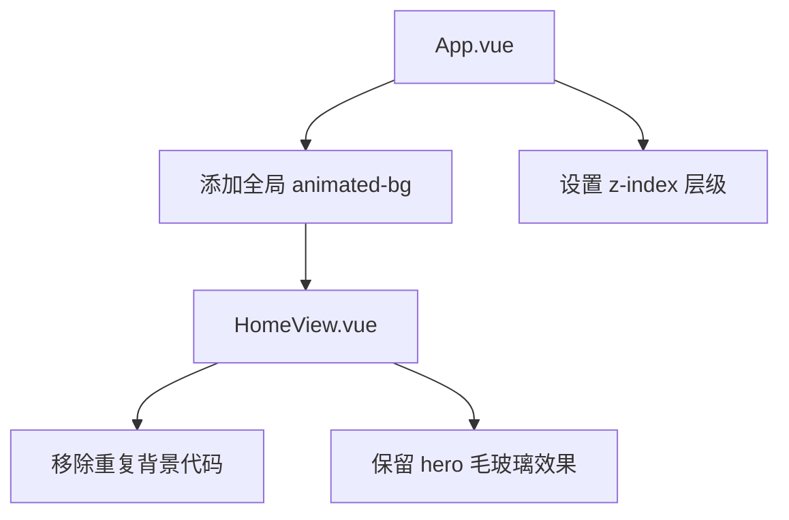

# 首页背景升级方案 - 全局简约科技风

## 用户需求确认

- ✅ 全局背景（贯穿所有页面，非仅首页）
- ✅ 简约但不是灰色
- ✅ 现代科技感（AI/SaaS 风格）
- ✅ 与 FigColor 品牌色协调（蓝 #0066cc → 紫 #7c3aed）

## 现状问题

当前背景实现的问题：
1. **仅在 HomeView.vue** - 其他页面没有统一背景
2. **Hero 区块有额外背景** - `background: rgba(255,255,255,0.7)` 造成视觉分层
3. **HomeView.vue 重复定义了全局样式** - 与 App.vue 职责不清

## 解决方案

### 核心思路

将背景作为全局样式放在 `App.vue`，HomeView.vue 移除重复的背景代码，保持简约。

### 设计方案

**主背景色**
```css
background: linear-gradient(
  135deg,
  #f8faff 0%,    /* 近白带微蓝 */
  #f0f4ff 40%,   /* 浅蓝 */
  #f5f2ff 70%,   /* 浅紫 */
  #fafaff 100%   /* 近白 */
);
```

**Glow Blobs（全局发光层）**
- Blob-1（左上）：`rgba(0, 102, 204, 0.12)` - 蓝色光晕
- Blob-2（右下）：`rgba(124, 58, 237, 0.10)` - 紫色光晕  
- Blob-3（中下）：`rgba(0, 102, 204, 0.08)` - 蓝补充

**网格（可选）**
- 40px 网格，`rgba(0, 102, 204, 0.035)` - 非常淡

## 实现计划



### 步骤

1. **App.vue** - 添加全局 animated-bg 背景层
2. **HomeView.vue** - 移除自己的 animated-bg 定义
3. **HomeView.vue** - 简化 hero-section（已有毛玻璃效果即可）
4. **global.css** - 可选：添加 --gradient-bg 变量

## 视觉效果

```
┌─────────────────────────────────────────┐
│  ┌─────────────────────────────────┐    │
│  │      Glow Blob 1 (蓝)          │    │
│  │                                 │    │
│  │    ┌─────────────────────┐      │    │
│  │    │   Page Content      │      │    │
│  │    │                     │      │    │
│  │    └─────────────────────┘      │    │
│  │              Glow Blob 2 (紫)  │    │
│  └─────────────────────────────────┘    │
└─────────────────────────────────────────┘

- 背景渐变：#f8faff → #f0f4ff → #f5f2ff → #fafaff
- 光晕位置：Blob-1 左上、Blob-2 右下、Blob-3 中下
- 内容区：白色/毛玻璃卡片
```

## 配色关系

| 元素 | 颜色 | 用途 |
|------|------|------|
| 背景渐变起点 | `#f8faff` | 近白，微蓝 |
| 背景渐变中点 | `#f0f4ff` / `#f5f2ff` | 浅蓝/浅紫 |
| Glow Blob 1 | `rgba(0,102,204,0.12)` | 品牌蓝 |
| Glow Blob 2 | `rgba(124,58,237,0.10)` | 品牌紫 |
| 卡片/内容 | `rgba(255,255,255,0.8)` | 毛玻璃白 |

## 简约设计原则

1. **去除网格** - 保持更干净
2. **光晕淡化** - 透明度降低（0.12/0.10/0.08）
3. **动画放缓** - 25s 周期更自然
4. **无重复层** - HomeView 不再定义背景