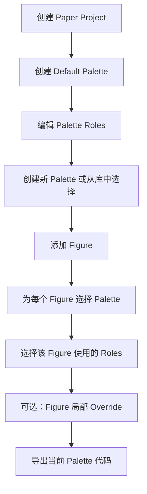

# Paper Project 功能设计

## 1. 目标

帮助用户保持整篇论文图表配色一致。

## 2. 技术栈

- **前端**: Vue 3 + TypeScript + Vite + Pinia
- **后端**: Go + Gin
- **数据库**: PostgreSQL

## 3. 核心功能

1. 创建 Paper Project
2. 设置 Control / Treatment / Highlight / Background 等角色颜色
3. 保存项目级 palette
4. 导出 Python / R / JSON / CSS 代码
5. 为不同 Figure 分配颜色

## 4. 数据模型（推荐 v1）

### 4.1 TypeScript 类型

```typescript
// 角色类型
type RoleType = 'semantic' | 'group' | 'ui' | 'custom'

// 单个调色板角色
type PaletteRole = {
  id: string
  paletteId: string
  key: string           // e.g. "control", "treatment", "ko", "wt"
  label: string         // e.g. "Control", "Treatment", "KO", "WT"
  color: string         // HEX
  roleType: RoleType   // semantic | group | ui | custom
  order: number         // 排序
  createdAt: string
  updatedAt: string
}

// 项目调色板
type ProjectPalette = {
  id: string
  projectId: string
  name: string
  basePaletteId?: string
  isDefault: boolean    // 是否默认调色板
  roles: PaletteRole[]
  createdAt: string
  updatedAt: string
}

// Figure 局部颜色覆盖
type FigureRoleOverride = {
  roleKey: string
  color: string
}

// Figure 分配
type FigureAssignment = {
  id: string
  projectId: string
  paletteId: string
  name: string
  panel?: string       // e.g. "A", "B", "C"
  chartType: string
  roleOverrides?: FigureRoleOverride[]
  notes?: string
  createdAt: string
  updatedAt: string
}

// 项目主体
type PaperProject = {
  id: string
  userId?: string      // 预留用户 ID，登录系统上线后可绑定
  name: string
  description?: string
  defaultPaletteId?: string
  createdAt: string
  updatedAt: string
}
```

### 4.2 PostgreSQL 表设计

```sql
-- PostgreSQL UUID 扩展
CREATE EXTENSION IF NOT EXISTS pgcrypto;

-- 项目表
CREATE TABLE paper_projects (
  id UUID PRIMARY KEY DEFAULT gen_random_uuid(),
  user_id UUID NULL,
  name TEXT NOT NULL,
  description TEXT NULL,
  default_palette_id UUID NULL,  -- P0 阶段暂不加外键，避免循环引用
  created_at TIMESTAMPTZ NOT NULL DEFAULT NOW(),
  updated_at TIMESTAMPTZ NOT NULL DEFAULT NOW()
);

-- P0 阶段暂不加 default_palette_id 外键，原因：
-- paper_projects 和 project_palettes 有循环引用关系
-- 推荐处理方式：
-- 1. 创建 paper_projects（不带 default_palette_id 外键）
-- 2. 创建 project_palettes
-- 3. ALTER TABLE paper_projects ADD CONSTRAINT
-- 或者在 service 层校验，P0 快速开发可暂不加外键

-- 项目调色板表
CREATE TABLE project_palettes (
  id UUID PRIMARY KEY DEFAULT gen_random_uuid(),
  project_id UUID NOT NULL REFERENCES paper_projects(id) ON DELETE CASCADE,
  name TEXT NOT NULL,
  base_palette_id UUID NULL,
  is_default BOOLEAN NOT NULL DEFAULT FALSE,
  created_at TIMESTAMPTZ NOT NULL DEFAULT NOW(),
  updated_at TIMESTAMPTZ NOT NULL DEFAULT NOW()
);

-- 调色板角色表
CREATE TABLE palette_roles (
  id UUID PRIMARY KEY DEFAULT gen_random_uuid(),
  palette_id UUID NOT NULL REFERENCES project_palettes(id) ON DELETE CASCADE,
  key TEXT NOT NULL,
  label TEXT NOT NULL,
  color TEXT NOT NULL CHECK (color ~ '^#[0-9A-Fa-f]{6}$'),
  role_type TEXT NOT NULL CHECK (role_type IN ('semantic', 'group', 'ui', 'custom')),
  sort_order INT NOT NULL DEFAULT 0,
  created_at TIMESTAMPTZ NOT NULL DEFAULT NOW(),
  updated_at TIMESTAMPTZ NOT NULL DEFAULT NOW(),
  UNIQUE (palette_id, key)
);

-- Figure 分配表
CREATE TABLE figure_assignments (
  id UUID PRIMARY KEY DEFAULT gen_random_uuid(),
  project_id UUID NOT NULL REFERENCES paper_projects(id) ON DELETE CASCADE,
  palette_id UUID NOT NULL REFERENCES project_palettes(id) ON DELETE RESTRICT,
  name TEXT NOT NULL,
  panel TEXT NULL,
  chart_type TEXT NOT NULL,
  notes TEXT NULL,
  created_at TIMESTAMPTZ NOT NULL DEFAULT NOW(),
  updated_at TIMESTAMPTZ NOT NULL DEFAULT NOW()
);

-- Figure 角色覆盖表
CREATE TABLE figure_role_overrides (
  id UUID PRIMARY KEY DEFAULT gen_random_uuid(),
  figure_id UUID NOT NULL REFERENCES figure_assignments(id) ON DELETE CASCADE,
  role_key TEXT NOT NULL,
  color TEXT NOT NULL CHECK (color ~ '^#[0-9A-Fa-f]{6}$'),
  UNIQUE (figure_id, role_key)
);
```

### 4.3 数据库设计说明

- **规范化**: 使用独立表存储 roles 和 overrides，避免 JSON 嵌套
- **级联删除**: `ON DELETE CASCADE` 确保删除项目时清理相关数据
- **引用保护**: `ON DELETE RESTRICT` 防止删除被 Figure 引用的 palette，提示用户先修改 Figure
- **预留 user_id**: 第一阶段允许 NULL，登录系统上线后绑定
- **is_default**: 标识默认调色板，便于 Figure 创建时引用

## 5. API 设计

### 5.1 Projects

| Method | Endpoint | Description |
|--------|----------|-------------|
| GET | `/api/projects` | 获取所有项目 |
| POST | `/api/projects` | 创建项目 |
| GET | `/api/projects/:projectId` | 获取项目详情 |
| PATCH | `/api/projects/:projectId` | 更新项目（部分更新） |
| DELETE | `/api/projects/:projectId` | 删除项目 |

### 5.2 Project Palettes

| Method | Endpoint | Description |
|--------|----------|-------------|
| GET | `/api/projects/:projectId/palettes` | 获取项目的所有调色板 |
| POST | `/api/projects/:projectId/palettes` | 创建调色板 |
| GET | `/api/projects/:projectId/palettes/:paletteId` | 获取调色板详情 |
| PATCH | `/api/projects/:projectId/palettes/:paletteId` | 更新调色板 |
| DELETE | `/api/projects/:projectId/palettes/:paletteId` | 删除调色板 |

### 5.3 Palette Roles

| Method | Endpoint | Description |
|--------|----------|-------------|
| POST | `/api/projects/:projectId/palettes/:paletteId/roles` | 添加角色 |
| PATCH | `/api/projects/:projectId/palettes/:paletteId/roles/:roleId` | 更新角色 |
| DELETE | `/api/projects/:projectId/palettes/:paletteId/roles/:roleId` | 删除角色 |

### 5.4 Figures

| Method | Endpoint | Description |
|--------|----------|-------------|
| GET | `/api/projects/:projectId/figures` | 获取项目的所有 Figure |
| POST | `/api/projects/:projectId/figures` | 创建 Figure 分配 |
| GET | `/api/projects/:projectId/figures/:figureId` | 获取 Figure 详情 |
| PATCH | `/api/projects/:projectId/figures/:figureId` | 更新 Figure |
| DELETE | `/api/projects/:projectId/figures/:figureId` | 删除 Figure |

### 5.5 Export

| Method | Endpoint | Description |
|--------|----------|-------------|
| GET | `/api/projects/:projectId/palettes/:paletteId/export?format=python` | 导出为 Python |
| GET | `/api/projects/:projectId/palettes/:paletteId/export?format=r` | 导出为 R |
| GET | `/api/projects/:projectId/palettes/:paletteId/export?format=json` | 导出为 JSON |
| GET | `/api/projects/:projectId/palettes/:paletteId/export?format=css` | 导出为 CSS |

### 5.6 API 设计说明

- **PATCH 替代 PUT**: 大多数情况下是部分更新（项目名、描述、默认调色板），而非完整替换
- **嵌套路由**: `/api/projects/:projectId/palettes/:paletteId` 比 `/api/palettes/:id` 更安全，可天然校验 palette 是否属于该 project
- **统一资源层级**: Projects → Palettes → Roles, Projects → Figures
- **权限控制**: 嵌套路由便于未来做项目级权限控制

## 6. 前端目录结构

```
src/
├── components/
│   └── project/
│       ├── ProjectCard.vue
│       ├── ProjectForm.vue
│       ├── PaletteEditor.vue
│       ├── RoleColorPicker.vue
│       └── FigureAssignmentCard.vue
├── views/
│   ├── ProjectsView.vue
│   └── ProjectDetailView.vue
├── stores/
│   └── projectStore.ts
├── types/
│   └── project.ts
└── lib/
    └── projectApi.ts
```

## 7. 后端目录结构

### 7.1 推荐 Go 项目惯例

```
backend/
├── cmd/
│   └── server/
│       └── main.go              # 入口文件
├── internal/
│   ├── config/
│   │   └── config.go            # 配置管理
│   ├── database/
│   │   ├── postgres.go         # PostgreSQL 连接
│   │   └── migrations/         # 数据库迁移
│   ├── middleware/
│   │   └── cors.go             # CORS 中间件
│   ├── project/                # 项目业务模块
│   │   ├── handler.go
│   │   ├── service.go
│   │   ├── repository.go
│   │   └── model.go
│   ├── palette/               # 调色板业务模块
│   │   ├── handler.go
│   │   ├── service.go
│   │   ├── repository.go
│   │   └── model.go
│   ├── figure/                # Figure 业务模块
│   │   ├── handler.go
│   │   ├── service.go
│   │   ├── repository.go
│   │   └── model.go
│   └── export/                # 导出业务模块
│       ├── handler.go
│       └── service.go
├── go.mod
└── Dockerfile
```

### 7.2 目录结构说明

- **cmd/server/main.go**: 应用入口
- **internal/**: 私有包，不对外暴露
- **按业务模块拆分**: project / palette / figure / export，比按层（models/handlers/services）更适合后期扩展
- **每个模块内**: handler → service → repository 分层

### 7.3 核心数据关系

```
paper_projects 1 - N project_palettes
project_palettes 1 - N palette_roles
paper_projects 1 - N figure_assignments
figure_assignments N - 1 project_palettes
figure_assignments 1 - N figure_role_overrides
```

### 7.4 业务模块划分

| 模块 | 职责 |
|------|------|
| project | 项目 CRUD，关联调色板和 Figure |
| palette | 调色板和角色管理 |
| figure | Figure 分配和局部覆盖 |
| export | 代码导出（Python/R/JSON/CSS） |

## 8. 用户流程



### 8.1 流程说明

**核心原则**: 不要让用户一开始就必须选择唯一的基础 Palette。

1. **创建 Paper Project** - 输入项目名称、描述，后端自动创建一个 Default Palette（isDefault=true）
2. **创建 / 管理 Project Palettes** - 用户可以编辑 Default Palette，或创建新 Palette（从基础 Palette 库选择，或手动创建）
3. **编辑 Palette Roles** - 编辑角色颜色（control/treatment/highlight/background 或自定义角色）
4. **添加 Figure** - 逐步添加 Figure 1A, Figure 1B, Figure 2A...
5. **为 Figure 选择 Palette** - 每个 Figure 引用一个 Palette，不同 Figure 可选不同 Palette
6. **选择该 Figure 使用的 Roles** - 某些 Figure 可能只用部分 roles
7. **可选：Figure 局部 Override** - 局部覆盖某些角色颜色
8. **导出当前 Palette 代码** - Python/R/JSON/CSS

### 8.2 多 Palette 场景

```
场景：论文包含多种图表类型，需要不同风格的 Palette

Figure 1A (barplot): Main Group Palette
  - roles: control, treatment, highlight

Figure 1B (boxplot): Main Group Palette
  - roles: control, treatment

Figure 2A (heatmap): Heatmap Sequential Palette
  - roles: low, high

Figure 3A (volcano plot): Volcano Diverging Palette
  - roles: down, ns, up

Figure 4A (survival curve): Main Group Palette
  - roles: control, treatment
```

**这就是为什么 Project Palette 应该是一对多（一个项目可以有多个 Palette），而不是一个项目只有一个 Palette**。

### 8.3 论文写作过程场景

```
场景：论文写作过程中逐步添加 Figure

Day 1: 创建项目 "RNA-seq Analysis 2024"
        后端自动创建 Default Palette
        默认角色: control=#3D5A80, treatment=#EE6C4D, highlight=#E9C46A, background=#F8F9FA
        
Day 3: 添加 Figure 1A (bar chart)
        选择 roles: [control, treatment]
        导出 Python 代码用于绘图

Day 7: 添加自定义角色 "WT" 和 "KO"
        添加 Figure 1B (scatter plot)
        选择 roles: [WT, KO, highlight]

Day 14: 添加 Figure 2A (volcano plot)
        复用之前的 roles
        发现需要局部覆盖 treatment 颜色
        使用 roleOverrides 功能
```

## 9. 导出格式示例

### Python
```python
colors = [
    { "key": "control", "color": "#3D5A80" },
    { "key": "treatment", "color": "#EE6C4D" },
    { "key": "highlight", "color": "#E9C46A" },
    { "key": "background", "color": "#F8F9FA" }
]

import matplotlib.pyplot as plt
plt.rcParams["axes.prop_cycle"] = plt.cycler(color=[c["color"] for c in colors])
```

### R
```r
colors <- list(
  list(key = "control", color = "#3D5A80"),
  list(key = "treatment", color = "#EE6C4D"),
  list(key = "highlight", color = "#E9C46A"),
  list(key = "background", color = "#F8F9FA")
)

scale_color_manual(values = sapply(colors, function(x) x$color))
scale_fill_manual(values = sapply(colors, function(x) x$color))
```

### JSON
```json
{
  "roles": [
    { "key": "control", "label": "Control", "color": "#3D5A80" },
    { "key": "treatment", "label": "Treatment", "color": "#EE6C4D" },
    { "key": "highlight", "label": "Highlight", "color": "#E9C46A" },
    { "key": "background", "label": "Background", "color": "#F8F9FA" }
  ]
}
```

### CSS
```css
:root {
  --role-control: #3D5A80;
  --role-treatment: #EE6C4D;
  --role-highlight: #E9C46A;
  --role-background: #F8F9FA;
}

/* 或者使用 data 属性 */
[data-palette-roles] {
  --control: #3D5A80;
  --treatment: #EE6C4D;
  --highlight: #E9C46A;
  --background: #F8F9FA;
}
```

**注意**：本文档描述完整 Paper Project 功能。当前开工范围只实现 P0，Figure Assignment、Export、自定义角色、多 Palette 管理、Override 均进入 P1/P2。

### P0 开工范围确认

**这次开工只做这些**：

1. Go + Gin 后端 skeleton
2. PostgreSQL migration
3. Project CRUD
4. 创建 Project 时自动创建 Default Palette
5. Default Palette 自动生成 4 个默认 roles（control, treatment, highlight, background）
6. 获取 Project detail 时返回 project + palettes + roles
7. 前端 ProjectsView
8. 前端 ProjectDetailView
9. PaletteEditor 支持修改默认角色颜色
10. 刷新后数据持久化

**暂时不做**：

- Figure Assignment
- Export
- 自定义角色
- 多 Palette 管理 UI
- Figure role override
- 登录系统
- 基础 Palette 模板选择

## 10. 实现优先级

### P0 - 核心功能
- 项目列表（ProjectsView）
- 创建 / 删除 / 重命名项目
- 默认 Project Palette
- 默认角色颜色：control / treatment / highlight / background
- 保存到后端

### P1 - 调色板编辑和导出
- PaletteEditor（调色板编辑器）
- 支持添加 / 删除 / 重命名角色（自定义角色）
- Figure Assignment（图分配）
- Python / R / JSON / CSS 导出

### P2 - 高级功能
- 从基础 Palette 创建 Project Palette
- Figure 局部颜色 override
- 复制项目
- 收藏 / 分享 / 登录绑定

### P3 - 增强功能
- 色盲安全检查
- 对比度检查
- Journal Style 推荐
- 多 Figure 一致性评分

### 优先级说明

**重点**: 自定义角色不应该放太晚。Paper Project 的核心价值不是固定四个颜色，而是让用户能把论文中的语义角色统一管理。

**调整**:
- P0 已包含默认角色颜色（control/treatment/highlight/background）
- P1 包含 PaletteEditor 和自定义角色（添加/删除/重命名）
- Figure 局部 override 放到 P2，因为需要先有基础 Palette

### P0 Acceptance Criteria（验收标准）

1. **创建项目**: 用户可以在 ProjectsView 创建 Paper Project，输入项目名称和描述
2. **自动创建 Default Palette**: 创建项目时，后端自动创建一个默认 Project Palette（isDefault=true，包含 4 个默认角色）
3. **默认角色**: 默认 Palette 包含 4 个角色：
   - control
   - treatment
   - highlight
   - background
4. **查看项目**: 用户进入 ProjectDetailView 后，可以看到项目名称、默认 Palette、角色颜色
5. **修改角色颜色**: 用户可以修改角色颜色并保存
6. **持久化**: 刷新页面后，项目和颜色仍然存在
7. **级联删除**: 删除项目后，相关 palettes 和 roles 被级联删除
8. **基础错误处理**:
   - project not found (404)
   - invalid color (400，格式需符合 `^#[0-9A-Fa-f]{6}$`)
   - duplicated role key (409，UNIQUE 约束)

### 开发顺序建议

1. **Step 1**: 建 backend skeleton (Go + Gin)
2. **Step 2**: 建 PostgreSQL migration (含 pgcrypto 扩展和所有表)
3. **Step 3**: 实现 project CRUD
4. **Step 4**: 实现创建项目时自动创建 default palette + 4 default roles
5. **Step 5**: 实现获取 project detail，返回 project + palettes + roles
6. **Step 6**: 前端 ProjectsView（项目列表）
7. **Step 7**: 前端 ProjectDetailView（项目详情 + Palette 编辑）
8. **Step 8**: PaletteEditor 支持修改 role color